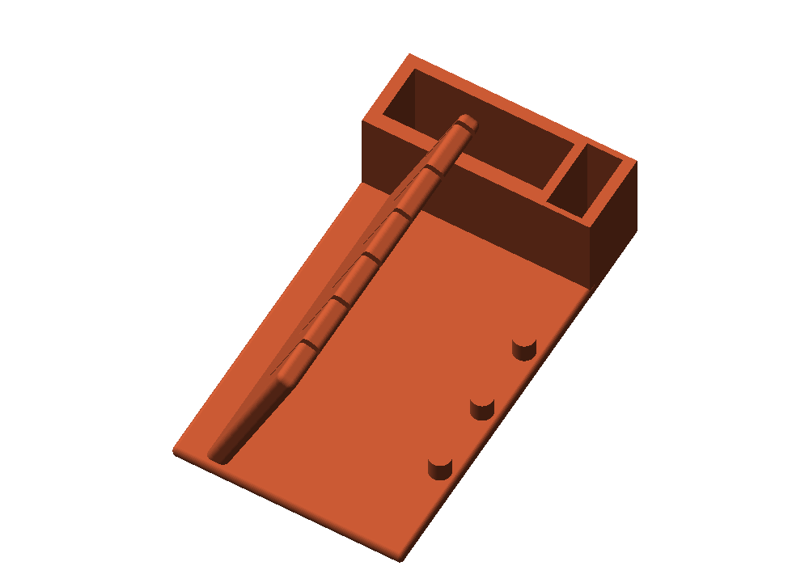

# BBQ Probe Spool Stand

A stand for BBQ thermometer probes. Probe cables wind onto spools that sit on the angled, slotted back panel, and three pegs on the base plate locate them. The box on one end has two open-top pockets and *"Luke's BBQ Probe Rack V3"* engraved on its end face.

This version is a single solid model. In V3, the pockets and the label were cut by negative volumes in the slicer. Now they're part of the model itself, so the STL slices correctly in any slicer.

 

## Files

| File | Description |
|------|-------------|
| [`files/bbq_probe_spool_stand_v3.stl`](files/bbq_probe_spool_stand_v3.stl) | **Print this.** One watertight solid, with the pockets and label already cut. |
| [`files/bbq_probe_spool_stand_v3.step`](files/bbq_probe_spool_stand_v3.step) | STEP for CAD. Flat faces, such as the box and pockets, are real planes. Curved surfaces from the original stand mesh are still made of facets. |
| [`files/bbq_probe_spool_stand_negative_volumes.3mf`](files/bbq_probe_spool_stand_negative_volumes.3mf) | The original V3 slicer project, with negative volumes. Kept for reference. |
| [`source/bake_pockets.py`](source/bake_pockets.py) | Rebuilds the STL from the 3MF: joins the parts and cuts the pockets and text |
| [`source/mesh_to_step.py`](source/mesh_to_step.py) | Converts the STL to the STEP file |

## Dimensions

| Feature | Size (mm) | Notes |
|---------|-----------|-------|
| Overall | 229.7 × 130.4 × 104.6 tall | |
| Storage box | 46 × 128 × 60 tall | Attached to the end of the stand |
| Pocket A (long) | **31.54 × 90**, open top | 1.5 mm floor, 58.5 mm deep. Walls 6.6 / 7.9 mm on the sides, 6.8 mm at the front |
| Pocket B (small) | **40 × 20**, open top | 1.5 mm floor, 58.5 mm deep. Walls 3.2 / 2.9 mm on the sides, 6.2 mm at the back |
| Divider between pockets | 5.0 thick | |
| Engraved label | 1.9 deep | "Luke's / BBQ Probe / Rack / V3", Rockwell Condensed, on the box's end face |
| Spool pegs | 3 × Ø12, 41 mm apart | On the base plate |

The pocket sizes and positions are taken directly from the negative volumes in the V3 3MF: 31.54 × 90 × 65 mm and 40 × 20 × 65 mm, starting 1.5 mm above the bed and coming out through the top of the box.

## Print Settings

These come from the V3 project file. They haven't been tested with the new STL yet.

| Setting | Value |
|---------|-------|
| Printer / process profile | Voron 2.4 350, 0.4 mm nozzle / 0.20mm Standard @Voron - BambuSettings2 |
| Filament | SunLu HighSpeed ABS (black) |
| Nozzle / bed / chamber | 250 °C / 100 °C (High Temp Plate) / 40 °C |
| Layer height | 0.2 mm |
| Walls | 3 |
| Top / bottom layers | 5 / 3 |
| Infill | 15% gyroid |
| Supports | Tree (auto), on build plate only, 25° threshold. These hold up the angled back panel. |
| Brim | None |
| Orientation | Flat on the base plate (as exported) |

**Pegs:** in the V3 project, the three pegs were separate parts set to 5 walls and 60% infill. That setting is lost when everything becomes one solid. To keep the pegs strong, add a modifier around them in the slicer, or raise the wall count for the whole print.

## Hardware / Bill of Materials

None. The stand is a single printed part.

## Credits

The angled stand and spool shape come from a downloaded model ("BBQ Probe Spool Stand.stl"). The pegs, storage box, pockets and label were added on top of it. *Source link not recorded yet.*

## Revision History

- **V3** (2026-11-20): pockets and label built into the model as one solid. STL and STEP exported, so no slicer negative volumes are needed.
- **V3** (earlier): storage box added, with the pockets and label cut by negative volumes in the slicer.
