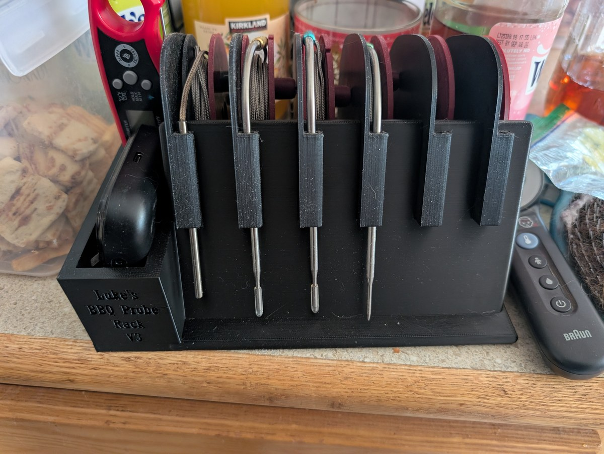
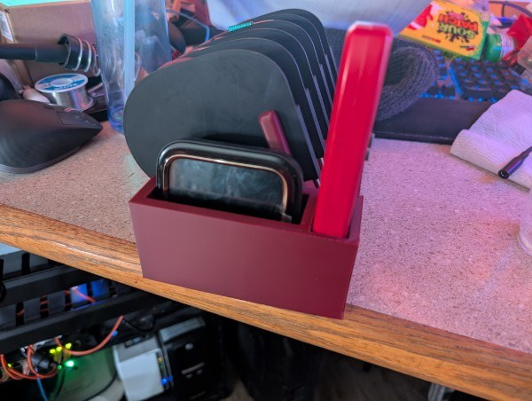
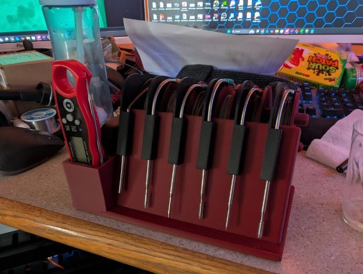
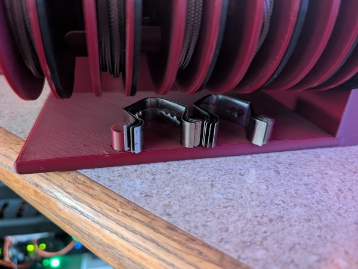
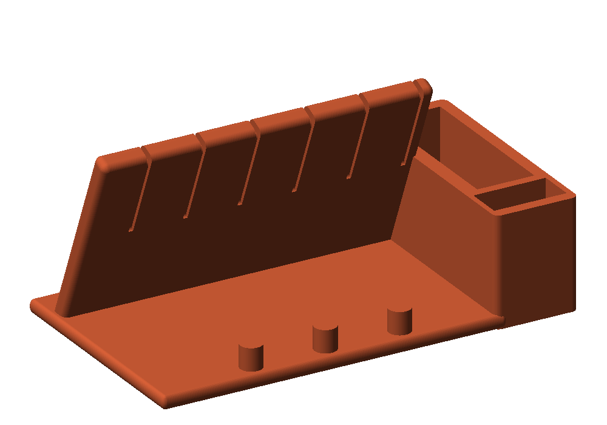
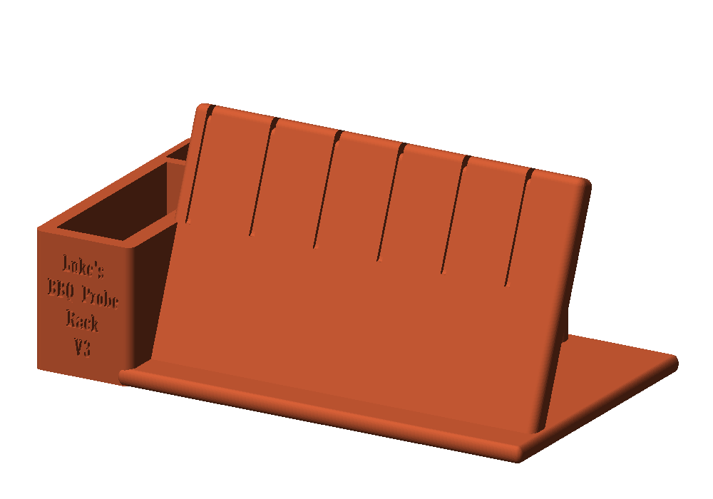

# BBQ Probe Spool Stand

A stand for BBQ thermometer probes. Each probe's cable winds onto a [rotary probe spool](https://www.printables.com/model/714295-bbq-probe-rotary-spool-remix) that sits behind the panel, and the probe tip hangs in a clip on the front. The box on one end has two open-top pockets, one for an INKBIRD WiFi thermometer base and one for an Alpha Grillers instant-read thermometer, and *"Luke's BBQ Probe Rack V3"* engraved on its end face. The three pegs on the base plate, behind the spools, hold the stainless probe grate clips.

| Pockets | Six probes | Clip pegs |
|---|---|---|
|  |  |  |

This version is a single solid model. In V3, the pockets and the label were cut by negative volumes in the slicer. Now they're part of the model itself, so the STL slices correctly in any slicer.

 

## Files

| File | Description |
|------|-------------|
| [`files/bbq_probe_spool_stand_v3.stl`](files/bbq_probe_spool_stand_v3.stl) | **Print this.** One watertight solid, with the pockets and label already cut. |
| [`files/bbq_probe_spool_stand_v3.step`](files/bbq_probe_spool_stand_v3.step) | STEP for CAD. Flat faces, such as the box and pockets, are real planes. Curved surfaces from the original stand mesh are still made of facets. |
| [`files/bbq_probe_spool_stand_negative_volumes.3mf`](files/bbq_probe_spool_stand_negative_volumes.3mf) | The original V3 slicer project, with negative volumes. Kept for reference. |
| [`source/bake_pockets.py`](source/bake_pockets.py) | Rebuilds the STL from the 3MF: joins the parts and cuts the pockets and text |
| [`source/mesh_to_step.py`](source/mesh_to_step.py) | Converts the STL to the STEP file |

## Dimensions

| Feature | Size (mm) | Notes |
|---------|-----------|-------|
| Overall | 229.7 × 130.4 × 104.6 tall | |
| Storage box | 46 × 128 × 60 tall | Attached to the end of the stand. The vertical corners are rounded to R3.75, matching the rounded edges on the stand's base plate and panel. |
| Pocket A (long) | **31.54 × 90**, open top | For the INKBIRD 6-probe WiFi thermometer base. 1.5 mm floor, 58.5 mm deep. Walls 6.6 / 7.9 mm on the sides, 6.8 mm at the front |
| Pocket B (small) | **40 × 20**, open top | For the Alpha Grillers instant-read thermometer, standing upright. 1.5 mm floor, 58.5 mm deep. Walls 3.2 / 2.9 mm on the sides, 6.2 mm at the back |
| Divider between pockets | 5.0 thick | |
| Engraved label | 1.9 deep | "Luke's / BBQ Probe / Rack / V3", Rockwell Condensed, on the box's end face |
| Clip pegs | 3 × Ø12, 41 mm apart | On the base plate behind the spools. They hold the probe grate clips. |

The pocket sizes and positions are taken directly from the negative volumes in the V3 3MF: 31.54 × 90 × 65 mm and 40 × 20 × 65 mm, starting 1.5 mm above the bed and coming out through the top of the box.

## Print Settings

These come from the V3 project file, which is the print shown in the photo. The new STL has the same shape, so it should print the same.

| Setting | Value |
|---------|-------|
| Printer / process profile | Voron 2.4 350, 0.4 mm nozzle / 0.20mm Standard @Voron - BambuSettings2 |
| Filament | SunLu HighSpeed ABS (black) |
| Nozzle / bed / chamber | 250 °C / 100 °C (High Temp Plate) / 40 °C |
| Layer height | 0.2 mm |
| Walls | 3 |
| Top / bottom layers | 5 / 3 |
| Infill | 15% gyroid |
| Supports | Tree (auto), on build plate only, 25° threshold. These hold up the angled back panel. |
| Brim | None |
| Orientation | Flat on the base plate (as exported) |

**Pegs:** in the V3 project, the three pegs were separate parts set to 5 walls and 60% infill. That setting is lost when everything becomes one solid. To keep the pegs strong, add a modifier around them in the slicer, or raise the wall count for the whole print.

## Hardware / Bill of Materials

| Qty | Item | Notes |
|-----|------|-------|
| 1 | INKBIRD 5GHz/2.4GHz WiFi & Bluetooth 5.1 meat thermometer, 6 probes | [Amazon](https://a.co/d/09NBpvpq). The base fits in pocket A, and the probes go on the spools. |
| 1 | Alpha Grillers instant-read digital meat thermometer | [Amazon](https://a.co/d/00PKUNLD). Fits in pocket B. |
| 1 per probe | Printed rotary probe spool | [BBQ Probe Rotary Spool Remix](https://www.printables.com/model/714295-bbq-probe-rotary-spool-remix) by OakenSkull. Printed separately and not included here. |

## Credits

- **Stand:** [Storage Stand for BBQ Probe Rotary Spool](https://www.printables.com/model/716595-storage-stand-for-bbq-probe-rotary-spool) by **OakenSkull_1238480** on Printables. Original files: https://www.printables.com/model/716595-storage-stand-for-bbq-probe-rotary-spool. The author marks it as an original design, made to hold 6 rotary spools. This remix uses its angled panel, probe clips and base.
- **Spools:** [BBQ Probe Rotary Spool Remix](https://www.printables.com/model/714295-bbq-probe-rotary-spool-remix) by **OakenSkull** (@OakenSkull_1238480) on Printables. It's a remix of T_om's "BBQ Meat Probe Spool" on Thingiverse, with the spindle made taller and its taper reversed so it press-fits without glue, plus a cutout to fit this stand. It works with FireBoard and Weber iGrill probes, and should fit most straight and right-angle probes. The spools aren't included in this folder. Download them from that page. Licensed [CC BY-NC-SA 4.0](https://creativecommons.org/licenses/by-nc-sa/4.0/), which means no commercial use.
- **Added in this remix:** the clip pegs, the storage box with its two pockets, and the engraved label.

## License

The original stand is licensed [CC BY-SA 4.0](https://creativecommons.org/licenses/by-sa/4.0/) (Attribution-ShareAlike). That license requires this remix to:

- **Credit the original:** "Storage Stand for BBQ Probe Rotary Spool" by OakenSkull_1238480, linked above.
- **Use the same license:** this remix is licensed **CC BY-SA 4.0** too.

Commercial use and further remixing of the stand are allowed, as long as the credit and the license stay with it. See [`LICENSE.md`](LICENSE.md).

**The spools are licensed differently.** The rotary spools are [CC BY-NC-SA 4.0](https://creativecommons.org/licenses/by-nc-sa/4.0/) (Attribution-NonCommercial-ShareAlike), so they **can't be sold or used commercially**. That includes selling them bundled with this stand. You can sell the stand on its own, but not with the spools.

## Revision History

- **V3.1** (2026-11-20): rounded the storage box's four vertical corners (R3.75) to match the stand's rounded edges.
- **V3** (2026-11-20): pockets and label built into the model as one solid. STL and STEP exported, so no slicer negative volumes are needed.
- **V3** (earlier): storage box added, with the pockets and label cut by negative volumes in the slicer.
