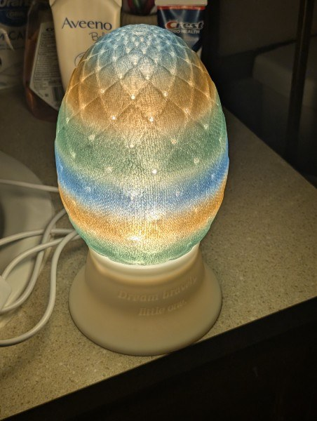
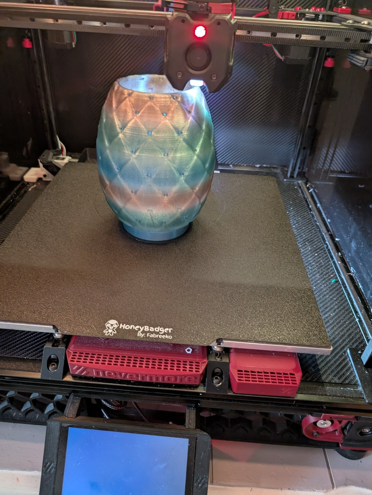
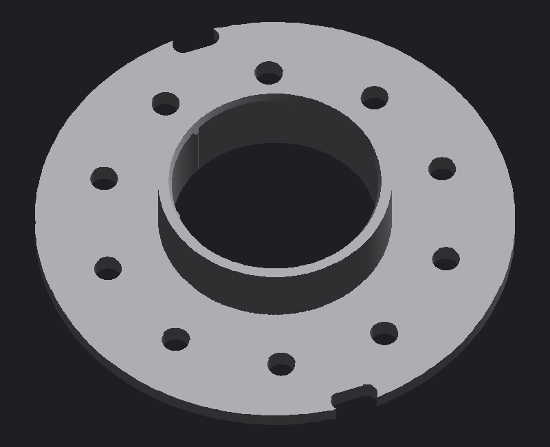
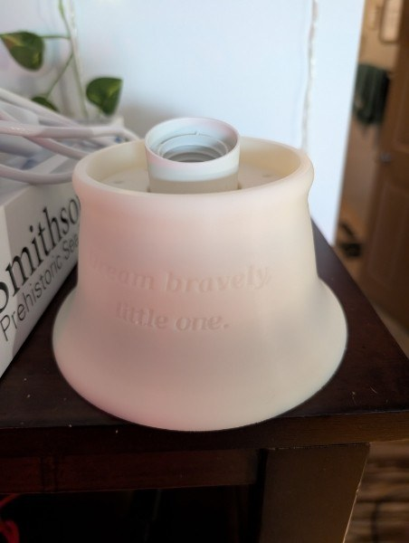

# Dragon Egg Nightlight

A nursery nightlight with three printed parts: a dragon-egg shade with overlapping scales, a bell-shaped base engraved with *"Dream bravely, little one."*, and a deck that holds an E26 lamp socket. The light shows through 156 small holes at the tips of the scales and through the thinner parts of each scale.

Rendered previews: [assembled](images/preview.png), [egg](images/egg.png).

## Files

| File | Description |
|------|-------------|
| [`files/dragon_egg_shell.stl.zip`](files/dragon_egg_shell.stl.zip) | The egg shade, zipped. **Unzip to get the STL to print.** About 1.95M triangles, 98 MB unzipped. |
| [`files/dragon_egg_shell.3mf`](files/dragon_egg_shell.3mf) | OrcaSlicer project for the egg, with the settings of the print that worked. Opens directly, no unzipping needed. |
| [`files/dragon_egg_shell.step.zip`](files/dragon_egg_shell.step.zip) | The egg as a STEP file, zipped (113 MB unzipped). Less detailed than the STL, so use it for CAD only, not for printing. |
| [`files/nightlight_base.stl`](files/nightlight_base.stl) / [`.step`](files/nightlight_base.step) | Base with the engraved quote, a collar for the egg and a notch for the cord |
| [`files/socket_deck.stl`](files/socket_deck.stl) / [`.step`](files/socket_deck.step) | Deck with a press-fit sleeve that holds the socket |
| [`files/socket_deck.3mf`](files/socket_deck.3mf) | OrcaSlicer project for the deck, with the settings of the print that worked |
| [`files/socket_hole_test_coupon.stl`](files/socket_hole_test_coupon.stl) / [`.step`](files/socket_hole_test_coupon.step) | Optional fit test: four sleeves with ribs at 37.00, 37.15, 37.30 and 37.45 mm |
| [`source/`](source/) | CadQuery scripts: `egg.py` (egg STEP), `egg_mesh.py` (high-res egg STL) and `base.py` (base, deck, coupon) |

The egg files are zipped because unzipped they're too big for GitHub, which warns at 50 MB and rejects files over 100 MB.

## Specs

| Item | Value |
|------|-------|
| Height assembled | About 264 mm (10.4 in) |
| Egg | 139.5 mm wide × 196 mm tall, 1.6 mm wall, about 300 g of filament |
| Base | 145 mm wide × 80 mm tall |
| Scales | 12 around, getting smaller toward the top, open (thick) edge facing up |
| Light holes | 156 holes, 2.6 mm, at the scale tips |
| Shrinkage compensation | **Every part is scaled up 0.6% (×1.006) for ABS.** Don't scale again in the slicer. The egg was printed in PLA at this scale, which shrinks less, and it still fits the base collar, so no change is needed. |

## Hardware / Bill of Materials

| Qty | Item | Notes |
|-----|------|-------|
| 1 | E26 lamp socket with cord and switch | [Sopoby socket on Amazon](https://link.amazon/B00PT0elm). The casing measures 37.45 mm across. The shade rings aren't used. |
| 1 | E26 LED bulb | Use a low-wattage LED bulb. An incandescent bulb gets too hot for the shade, especially a PLA one, which softens at around 55–60 °C. |

*Disclosure: the Amazon links on this page (the lamp socket above and the filament under Print Settings) are affiliate links. I may earn a commission on purchases made through them, at no extra cost to you.*

## Socket Fit

The deck holds the socket by its smooth casing, not the threads. The hole is 37.85 mm, and six crush ribs narrow it to **37.00 mm**, a 0.45 mm press fit. The ribs flatten as the socket goes in. A 12 mm sleeve under the deck grips about 15 mm of the casing, and both ends of the hole are flared so the socket starts in easily.

37.00 mm is the size that felt right on the test coupon. If a new socket or a different filament fits differently, print the coupon, choose the size that fits best, and change `RIB_D` in `source/base.py`.

## Print Settings

| Part | Orientation | Supports |
|------|-------------|----------|
| Socket deck | Flat, with the sleeve pointing **up** | None |
| Test coupon | Flat | None |
| Egg | Upright, standing on its skirt with the open end down (as exported) | None |
| Base | Upright, with the wide foot on the bed (as exported) | None |

### Socket deck: tested ✅

Printed on the Voron 2.4 350 in OrcaSlicer 2.5, and the socket fit is good. The full slicer project is in [`files/socket_deck.3mf`](files/socket_deck.3mf): open it in OrcaSlicer to reuse these settings.

| Setting | Value |
|---------|-------|
| Printer profile | Voron 2.4 350, 0.4 mm nozzle |
| Process profile | 0.20mm Standard @Voron - EnderwireParts |
| Filament | SunLu HighSpeed ABS (white) |
| Nozzle temp | 255 °C |
| Bed | High Temp Plate, 105 °C |
| Chamber | 40 °C |
| Layer height | 0.2 mm (first layer 0.2 mm) |
| Walls | 4 (Arachne), 0.4 mm line width |
| Top / bottom layers | 4 / 4 |
| Infill | 40% gyroid |
| Supports | None |
| Brim | Painted, 5 mm |
| Part cooling fan | 5–50%, off for the first 3 layers |
| Speeds | Walls 100 mm/s, infill 150 mm/s, acceleration 3500 mm/s² |
| Flow | Filament 0.977 × print 1.01 |
| Elephant-foot compensation | 0.15 mm |
| Hole / contour compensation | 0 (all sizing is in the model) |

### Egg: tested ✅

Printed in rainbow translucent PLA. The color bands come from the filament itself, not from color changes in the slicer. The full slicer project is in [`files/dragon_egg_shell.3mf`](files/dragon_egg_shell.3mf). Settings that differ from the deck are in **bold**.

| Setting | Value |
|---------|-------|
| Printer / process profile | Same as the deck |
| Filament | **[Amolen PLA, Rainbow Translucent](https://link.amazon/B01m4blD7)** (affiliate link) |
| Nozzle temp | **240 °C (230 °C first layer)** |
| Bed | High Temp Plate, **60 °C** |
| Chamber | **None (PLA)** |
| Layer height | 0.2 mm (first layer 0.2 mm) |
| Walls | **3** (Arachne), 0.4 mm line width |
| Top / bottom layers | 4 / 4 |
| Infill | **30%** gyroid |
| Supports | None |
| Brim | **Outer only, 5 mm** |
| Part cooling fan | **100%**, off for the first layer only. Auxiliary fan 70%. |
| Speeds | **Outer wall 50 mm/s**, inner walls 100 mm/s, infill 150 mm/s, acceleration 3500 mm/s² |
| Flow | Filament 0.98 × print 1.01 |
| Pressure advance | 0.025 |
| Elephant-foot compensation | 0.15 mm |

### Base: tested ✅

Printed with the same filament and settings as the socket deck: SunLu HighSpeed ABS (white), 255 °C nozzle, 105 °C bed, 40 °C chamber, 4 walls, 40% gyroid infill. See the deck table above and [`files/socket_deck.3mf`](files/socket_deck.3mf).

## Assembly

1. Push the socket into the deck sleeve from below, bulb end up, until about 18 mm of it sticks up above the deck.
2. Turn the deck so the sleeve hangs down, then set it on the ledge inside the base. Route the cord out through the notch in the base.
3. Put the bulb in the socket.
4. Drop the egg's skirt into the collar on the base.

## License

Repository default: model files and docs are [CC BY-NC-SA 4.0](https://creativecommons.org/licenses/by-nc-sa/4.0/) (credit required, no commercial use, remixes keep the license). Code in `source/` is MIT. See the repository [`LICENSE`](../../LICENSE).

## Revision History

- **v10** (2026-11-19): crush ribs on the deck set to 37.00 mm, the size chosen with the fit coupon. Base and deck (ABS) and egg (rainbow translucent PLA) printed and tested on 2026-11-20. The lamp is assembled and working.
- **v9**: deck redesigned to grip the socket casing (measured 37.45 mm) with crush ribs and a sleeve. New 4-size fit coupon.
- **v8**: scales flipped to open upward. Egg STL rebuilt at high resolution (about 1.95M triangles).
- **v7**: overlapping pointed scales replaced the earlier cushion pattern. Light holes moved to the scale tips.
- **v1–v6**: earlier egg textures (scalloped, cushion) and the first version of the base and deck.
