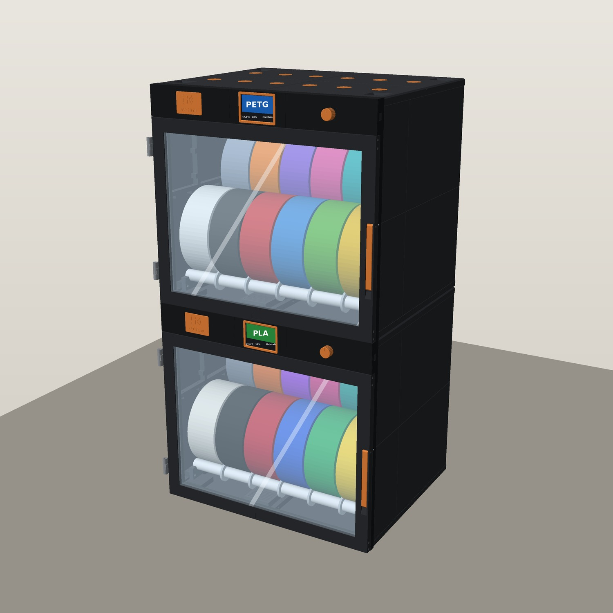
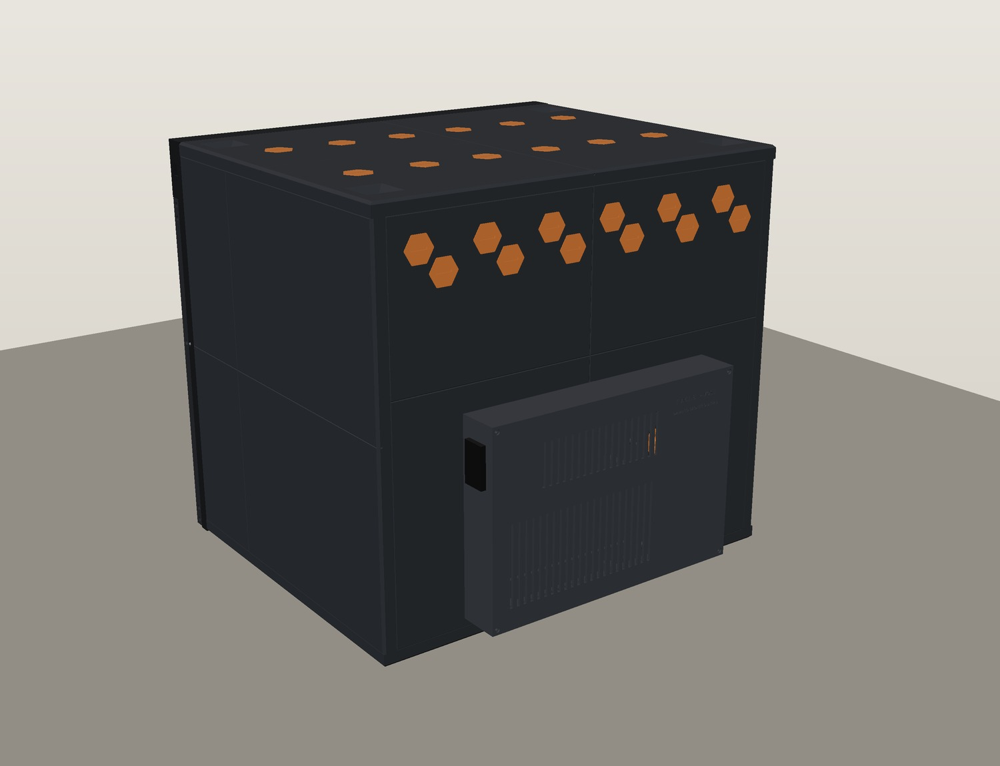
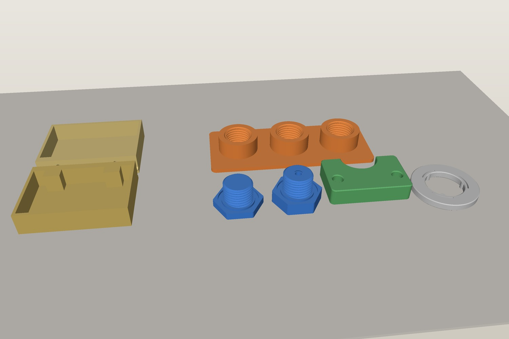
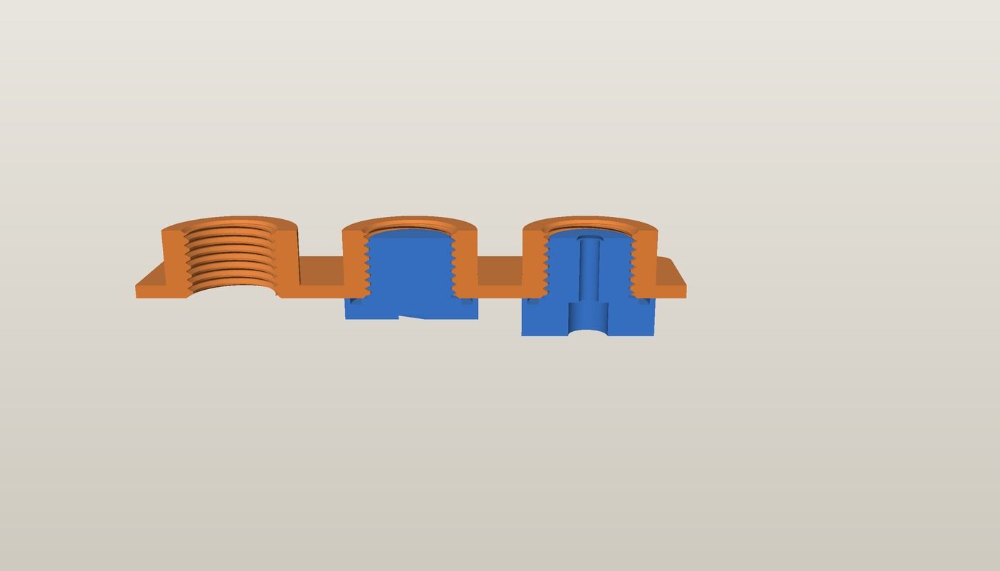
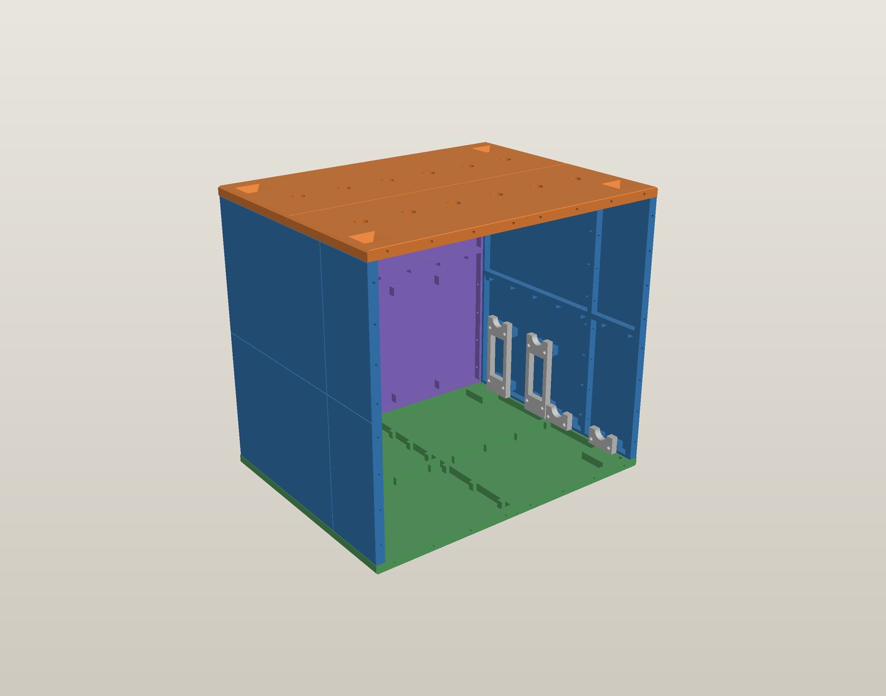
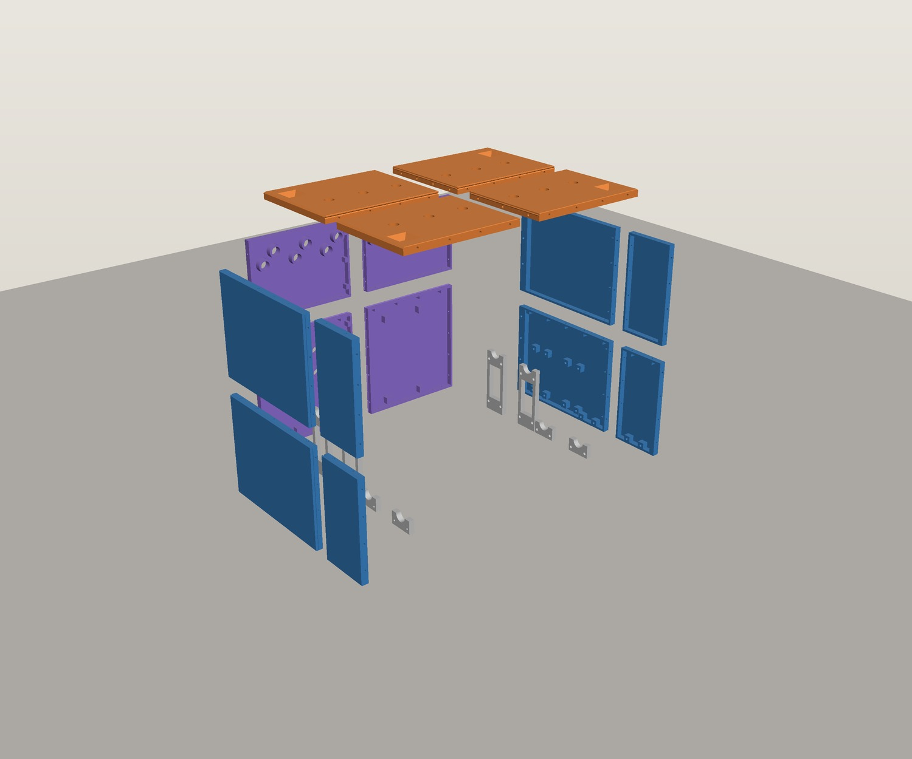
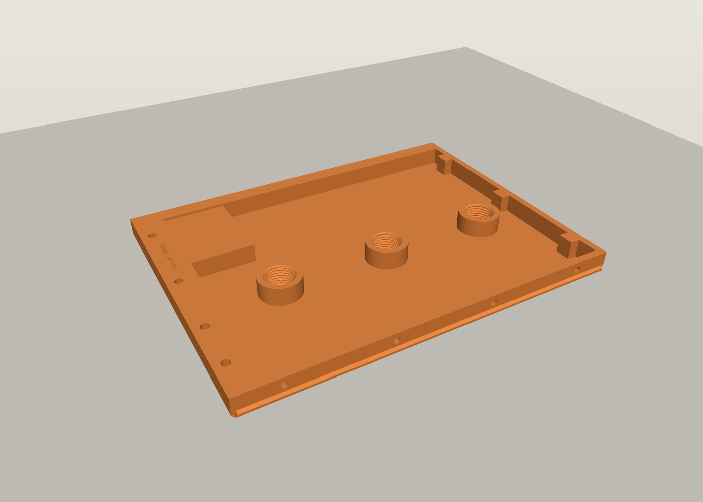
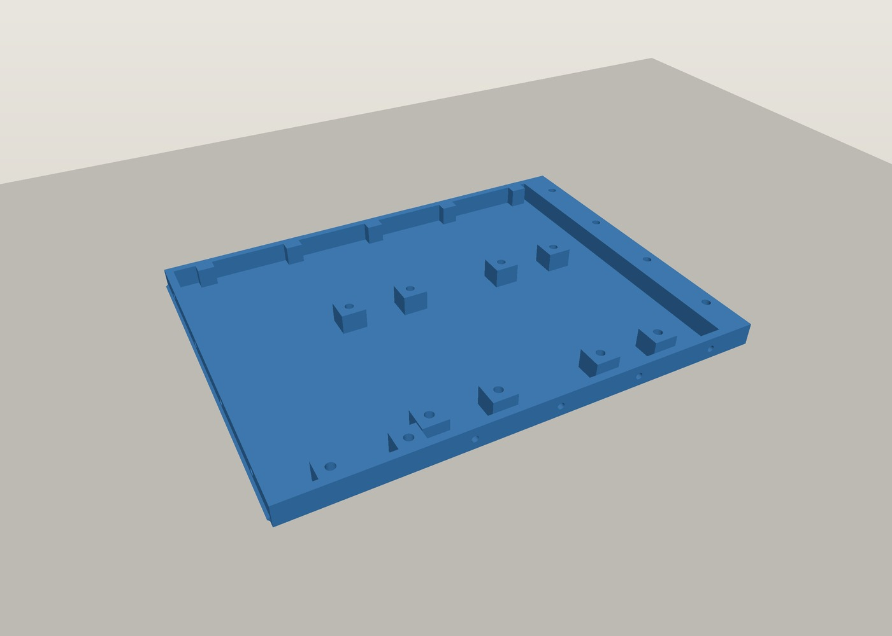
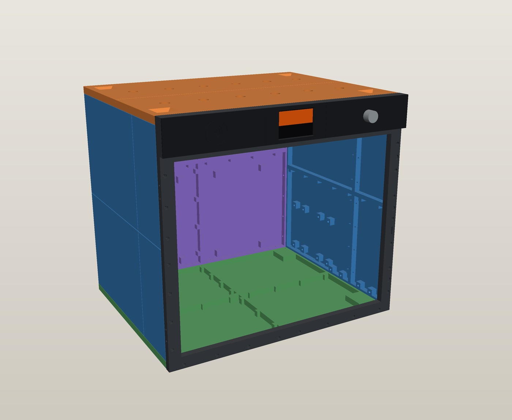
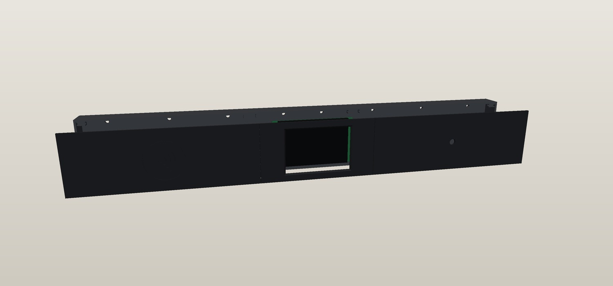

# Filament Dry Cabinet: Design Spec (v0.11)

This spec is for review before any CAD. v0.2 includes your answers to the open questions (§10). It sets the layout, construction, electronics, ESPHome control and the Spoolman slot scheme for **one cabinet**. You'll build **one cabinet per material family**: PLA, PETG, ABS/ASA, and so on.

## 1. Requirements

| # | Requirement | How this design meets it |
|---|-------------|------------------------------|
| R1 | Filament storage that also dehumidifies | Sealed, insulated chamber with a **low-voltage PTC heater**, a circulation fan and **pull-out silica gel cartridges** (§5) |
| R2 | Modular, looks like the concept picture | **Printed tile panels** (each ≤ 330 mm, to fit the 350 mm bed) bolted together, a dark frame and a full-width glass door (§4) |
| R3 | PVC or other hardware-store parts as spool shelves | Spools roll on **3/4 in Sch 40 PVC pipe** (26.7 mm OD) set in printed cradles (§4.3) |
| R4 | ESPHome (ESP32) with local controls and status | ESP32-S3, a **3.5 in IPS touch TFT and rotary encoder** for setpoints, plus the HA API and a local web page (§6, §7) |
| R5 | SK6812 LED lighting | **SK6812 RGBW** strip under the front header, 5 LEDs per slot, so it can **light up a single slot** (§6.4) |
| R6 | Front label, and an index position for each spool that Spoolman can manage | **The material label is shown on the 3.5 in TFT** (v0.8, replaces the printed plate), set from the menu or HA, plus a small printed backup tag on the door rail. **Slot IDs F1–F6 and B1–B6** on the door rail (§8). |
| R7 | **≤ 20 in (508 mm) deep** for standard shelves, **≤ 20 in shelf spacing** | **442 mm (17.4 in)** cabinet, **492 mm (19.4 in)** with the rear control pod, using offset-height rows. **494 mm (19.4 in) tall** with the 68 mm header. (§3) |
| R8 | IEC 320 C14 fused inlet | **Fused and switched C14 module** in the rear control pod (§6.1) |
| R9 | About 12 spools | **12 × 1 kg spools** (200 mm across, up to 75 mm wide) |
| R10 | PTFE feed ports that can be closed off, on the **top and back** | **12 top ports** (one per slot) and **12 back ports**, all using one plug-in **port module**: PTFE or sealed blank (§4.6) |
| R11 | Stackable | Feet nest into **pockets in the cabinet below**, with optional side links (§4.7) |
| R12 | 120 V mains only | Inlet, fuse and PSU are specified for 120 V (§6.1) |
| R13 | Works with **OpenPrintTag** NFC spool tags | A **PN5180 NFC tap pad** in the front header. Tap a spool to check it into a slot, and the slot is written to Spoolman's Location field (§4.4, §6.5, §8). |

## 2. Concept

 

Renders are drawn from the spec dimensions (§3). The original inspiration image:

## 3. Layout (chosen: one level, two offset rows of six)

**Spools roll on two PVC rods per row**, with their axles running side to side, so their faces point out the door like in the concept picture. Two rods 110 mm apart put a 200 mm spool's centre **99 mm above the rod centres**.

**The back row is raised 120 mm.** This lets the two rows overlap in depth (centres 169 mm apart instead of 207 mm). The back spools show above the front ones, so you can read them through the door. It also leaves a **service void under the back row, about 184 × 142 × 500 mm**, which holds the heater, fan duct and desiccant cartridges without adding any height. In v0.2 the front rods sit 30 mm above the floor, so the void is 137 mm tall.

**There's 85 mm of lift room above the back row**, so you can lift a back spool up and over the front spool to take it out. **Kept in v0.2**, since your shelves allow 20 in. Without it, the cabinet would be 408 mm / 16.1 in tall.

### Overall size (layout A)

| | mm | in |
|---|---|---|
| Width | 531 | 20.9 |
| Depth (cabinet) | 442 | 17.4 |
| Depth with the rear control pod | 492 | **19.4 (< 20)** |
| Height (with 10 mm stacking feet) | **494** | **19.4** |
| Height per cabinet when stacked (feet nest into the pockets) | 484 | 19.1 |
| Interior (W × D × H) | 500 × 399 × 452 | 19.7 × 15.7 × 17.8 |

### Layout options considered (all 12 spools)

| Option | Arrangement | W × D × H (in) | Notes |
|---|---|---|---|
| **A (chosen)** | 1 level, 2 offset rows × 6 | **21.3 × 17.6 (19.6 with pod) × 19.5** | Uses the full shelf depth. Low enough to fit under typical shelf spacing. Dead space houses the heater and desiccant. |
| B | 2 levels × (2 offset rows × 3) | 11.8 × 17.6 × 36.9 | Narrow but very tall. Won't fit between most shelves. |
| C | 3 levels × 4, single row | 15.0 × 10.9 × 31.1 | Shallow and tall. Wastes half the shelf depth. |

`source/layout.py` recalculates all of this. Change the spool size, rod size or offset and rerun it.

## 4. Construction

### 4.1 Shell: printed tile panels
- **Walls are 15.7 mm thick** (v0.7; was 20): a printed tile tray (2.4 mm skin plus 5 mm edge ribs) holding **1/2 in XPS foam board** (hardware store) in a 13.3 mm pocket, with the inside faced in **aluminium foil tape**. The foil works as a vapour barrier and reflects heat back in.
- **Tiles are ≤ 330 × 330 mm** (350 mm bed). Each face is a 2 × 2 grid of tiles: sides, top, bottom and back, **20 tiles** in all, plus a front frame. No corner posts are needed: the top and bottom span the full width, and the sides and back bolt into solid landing strips on them (§13).
- **Tiles join** with tongue-and-groove edges, **M4 heat-set inserts and bolts**, and foam tape in the seams. You could swap a side tile later for one with a pass-through port or a window.
- **Material: ABS or ASA for every printed part** (your choice, v0.2). That gives every cabinet the same parts and lets any cabinet run up to 60 °C. ASA is better for parts that get sunlight or UV.
- **Feet:** printed, 10 mm tall, and they **nest into pockets in the top of the cabinet below** (§4.7).

### 4.2 Door
- A printed frame with **two panes of clear polycarbonate** (hardware-store "Lexan", 2–2.5 mm) and a 6 mm air gap. That insulates about twice as well as one pane, and stops condensation on the glass.
- **EPDM foam weatherstrip** around the opening, compressed by **magnetic catches** (10 × 3 mm neodymium magnets in printed pockets), plus a printed pull handle.
- **Printed hinges** with steel pins (M3 bolts or 1/8 in rod).
- A **reed switch** detects when the door is open. It turns the lights on and pauses the heater and fan.

### 4.3 Spool rods, cradles and index collars
- **4 × 3/4 in Sch 40 PVC rods**, each cut to about 498 mm (interior width minus 2 mm). Two carry the front row and two carry the back row.
- **Printed U-cradles** on the side walls let the rods turn, so spools spin freely and can feed out. The rods also lift straight out for cleaning. The back-row cradles sit on printed risers, 120 mm higher.
- **Index collars:** printed 46 mm rings, 5 mm wide, every **80 mm** (75 mm spool plus 5 mm gap). They **slide on from the rod end** (the rods lift out) and **three spring tabs grip the PVC**, so they can be moved. A split ring that clips on sideways would be too stiff at this size (v0.7). They keep spools in their slots. Slot numbers are on the door rail, since the rods turn.

### 4.4 Front header and on-screen label
- A **68 mm header** above the door (v0.9; was 60 mm, grown for the screen) holds, from left to right:
  - the **NFC tap pad**, a recessed area with a printed tap icon over the PN5180 antenna
  - the **3.5 in IPS TFT with capacitive touch** (480 × 320 landscape, 74.0 × 49.6 mm touch/viewing area, board 98 × 55.5 mm), centred. The chosen module and its drawing are in **§6.6**. **It is the cabinet's label** (v0.8): the material name in large letters (about 18 mm tall) on a colour band, with temperature, humidity and mode below. See §7 for the screen behaviour.
  - the **encoder knob**
- **The printed label plate is gone** (v0.8). The name is a setting, so changing what a cabinet holds needs no reprint.
- **Backup tag:** a small printed tag (about 40 × 12 mm) clips into a slot at the left end of the door's bottom rail, so the cabinet is still identified when it's unplugged.
- **Touch-ready (v0.8.1):** the BOM uses a **capacitive touchscreen** module (FT6336U), so touch can be added in firmware later without changing hardware. The **encoder stays** as the main control. The bezel window must leave the whole touch surface open (no clear cover in front of the panel), with the panel front at most about 1.5 mm behind the bezel face so a finger reaches the edges.
- **Display mount:** the board is held by its **four 3.2 mm holes (92.0 × 49.5 mm pattern)** on printed standoffs with M3 screws (or M2.5 self-tapping), mounted landscape with the 14-pin header at one end. The bezel window is **75.0 × 50.6 mm** (viewing area + 0.5 mm each side), offset 2.33 mm from the hole-pattern centre towards the end away from the pins. The bezel must **not press on the touch glass**: leave about 0.3 mm air gap. The 68 mm header leaves 6.25 mm above and below the 55.5 mm board.
- **The tap pad has no metal over it**, and the plastic covering the antenna is no more than 2–3 mm thick. The 68 mm header also gives the PN5180 more room. If a module still doesn't fit, the header can grow by 2 more mm (70 mm, cabinet 496 mm / 19.5 in).
- The **slot numbers 1–6** are also moulded into the door's bottom rail, lined up with the columns.

### 4.5 Rear control pod (outside the chamber)
- A 50 mm deep printed box on the back panel. It holds the **IEC C14 inlet**, the **24 V PSU** and the **ESP32 board**, so mains wiring and electronics stay out of the heated, closed chamber.
- Wires pass into the chamber through a sealed gland.
- A removable back cover gives access, with ventilation slots for the PSU.

### 4.6 Closable PTFE ports (top and back)

**One port design is used everywhere.** Each tile gets a threaded **port socket**, a printed sleeve through the wall. A plug-in **port module** screws into the socket, sealed with an **O-ring**. The module comes in three versions:

| Module | Use |
|---|---|
| **PTFE pass-through** | **PC4-M10 push-fit coupler** on the outside for the 4 mm OD PTFE tube to the printer. Inside, a short PTFE guide tube runs toward the spool. |
| **Blank plug** | Seals any unused socket. It's the default in every socket. |
| **Feed cap** | Push-fit cap over the coupler for when the tube is disconnected but you want to keep the PTFE routing |

**Port positions:**
- **Top: 12 ports, one per slot.** They sit straight above each spool, at the front-row and back-row lines (§3 drawing). Filament comes off the top of the spool straight up.
- **Back: 12 ports in two staggered rows**, high on the back wall above the control pod. Guide tubes inside run up over the back row and down to each slot. **Use the back ports when cabinets are stacked**, since the cabinet above covers the top ports.

**Seal:** an O-ring on each module plus foam tape around the socket sleeve, so a closed port seals as well as the rest of the wall.

**Socket size:** M20 × 2 printed thread, 15.7 mm long (the full wall). The module has a hex flange (30 mm across flats) with a **22 × 2 mm O-ring** in a face groove that seals against the outside skin. (v0.6 said 16 × 2, but a 16 mm ring can't fit round an M20 thread.) The thread clearance is chosen with the coupon in §12.

### 4.7 Stacking

- **Feet nest into pockets:** each cabinet has four 10 mm feet that drop into matching **pockets in the roof** of the cabinet below. That keeps them aligned and stops them sliding.
- **Optional side links:** printed **link plates** bolt across the seam on each side, so a stack can't tip.
- **Limits:** stacks of **2, or 3 at most**. A loaded cabinet weighs roughly 12 kg of spools plus the cabinet itself, so the roof tiles get extra ribs around the pockets.
- **Power and ports:** every cabinet has its own inlet and controller. Stacking doesn't block the rear pods or the back ports.

## 5. Drying system

**How it works:** warm air holds the same amount of water at a much lower relative humidity, and warm plastic gives up moisture. The heater warms the chamber gently, and the **fan pulls chamber air down through the desiccant cartridges and over the PTC heater**. Warm, dry air leaves along the floor at the front, rises up the inside of the door, which also keeps the door glass clear, and returns down the back through the desiccant. Moisture driven out of the spools ends up in the silica gel, not back in the filament.

| Item | Spec |
|---|---|
| Heater | **24 V PTC element with fins, 150 W, the same in every cabinet**, in a printed **ABS/ASA** duct on standoffs. **PID control** sets how much of that power is used for each cabinet (§7). |
| Fan | 24 V **4-pin PWM** fan (60–80 mm) with tach, so the firmware can tell if it stops |
| Desiccant | **2 pull-out cartridges, about 300–400 g of orange indicating silica gel each**. They sit in the return-air path in the service void. |
| Recharging | Empty the gel into a metal tray and dry it in an oven at the temperature on the gel's packaging. **The printed cartridges can't go in the oven.** Firmware counts the days since the last recharge, and watches for absolute humidity creeping up. |
| Heat loss (estimate) | About 40 W at ΔT 15 °C, 65 W at ΔT 25 °C, and 90 W at ΔT 35 °C (walls U ≈ 1.5, twin-pane door U ≈ 2.7 W/m²K). 150 W gives a 60 °C cabinet headroom in a cool room and a fast warm-up. In a 40 °C PLA cabinet, PID simply runs it at a low duty, roughly 25–40 %. |

### Default settings per cabinet (storage, not hard drying)

| Cabinet | Max chamber temp | Target RH | Notes |
|---|---|---|---|
| PLA / PLA+ / silk | 40 °C | ≤ 30 % | Never above 45 °C |
| PETG / PCTG | 50 °C | ≤ 20 % | |
| ABS / ASA | 55 °C | ≤ 20 % | |
| TPU | 40 °C | ≤ 20 % | |
| Nylon / PC / CF blends | 60 °C | ≤ 10–15 % | Extra desiccant |

There's also a **"Dry" mode** that runs a timed cycle at the cabinet's maximum temperature, such as 6 h at 50 °C for PETG. It's a top-up, not a replacement for a proper filament dryer.

## 6. Electronics

### 6.1 Power
- **Mains: 120 V only.**
- **Inlet:** a UL-recognised IEC 320 C14 panel module with a **fuse holder and switch** (5 × 20 mm, **3.15 A T** slow-blow, 250 V rated). Earth (PE) goes to the PSU's FG terminal and to any metal parts. Use 18 AWG wire with ferrules, plus strain relief. The module snaps into a printed cutout, sized from the datasheet of the exact part you buy.
- **PSU:** **Mean Well LRS-200-24** (24 V, 8.8 A) in its enclosed metal case, the same in every cabinet.
- **5 V:** a 24 → 5 V buck converter (3–5 A) for the LEDs, display and ESP32. The LED feed has its own 3 A fuse.

**Power budget at 24 V:** heater 6.3 A, fan 0.1–0.3 A, 5 V loads about 0.8 A (LEDs at full white about 3 A at 5 V). The peak is about 7.4 A with the 150 W heater, within the LRS-200's 8.8 A.

### 6.2 Controller and I/O (ESP32-S3-DevKitC-1 N16R8)

| Function | Part | ESP32 interface |
|---|---|---|
| Chamber T/RH | **SHT45** (top rear, out of the direct heater flow) | I2C |
| Desiccant-outlet T/RH | SHT40 (shows how well the desiccant is working) | I2C (second address or second bus) |
| Room T/RH (optional) | SHT40 in the control pod | I2C |
| Heater outlet temp | 10 k NTC (or DS18B20) at the duct outlet | ADC (or 1-wire) |
| Heater | logic-level N-MOSFET, low side | GPIO, `slow_pwm` (about 5 s period) |
| Fan | 4-pin PWM | LEDC at 25 kHz, tach to `pulse_counter` |
| LEDs | SK6812 RGBW, about 30 LEDs | `esp32_rmt_led_strip`, via a **74AHCT125** level shifter, 330 Ω series resistor and 1000 µF at the strip |
| Display | **3.5 in IPS SPI TFT, 480 × 320, ST7796 controller, FT6336U capacitive touch** (§6.6) (ST7789 or ILI9341 IPS panel + FT6336U touch controller) | SPI (shared with the PN5180, own CS) + **backlight on an LEDC PWM pin** via a small transistor |
| Touch (wired now, firmware later) | FT6336U capacitive, on the **I2C bus** (shared with the sensors) + **INT and RST pins reserved**. A resistive XPT2046 board also works: it goes on SPI with its own CS + IRQ pin. | ESPHome `ft63x6` (or `xpt2046`) touchscreen, enabled in a later phase |
| Local control | EC11 rotary encoder with push switch | `rotary_encoder` + GPIO |
| Door | reed switch + magnet | GPIO (`binary_sensor`) |
| Buzzer (optional) | piezo for alarms | GPIO / LEDC |

### 6.3 Safety (in layers)
1. **Hardware, cannot be overridden:** a **KSD301 85 °C auto-reset thermostat** and a **102 °C one-shot thermal fuse (TCO)** in series with the heater's 24 V feed, mounted on the duct outlet. The PTC element also limits itself.
2. **Firmware interlocks:** the heater is forced off if:
   - the chamber is above its maximum + 5 °C, or the heater outlet is above its limit
   - either sensor reads NaN, or a reading hasn't updated for 60 s
   - the fan tach is below its minimum while heating
   - the door is open
   - a heater cycle runs longer than the watchdog limit
3. **Mains** stays only in the rear pod: an enclosed PSU, a fused inlet and an earthed metal PSU case. Only 24 V goes into the chamber.

### 6.4 Lighting
- One **SK6812 RGBW** strip (60/m) runs under the front header, aimed down and back. That's about **30 LEDs, 5 per slot column**.
- An ESPHome **partition** light is set up for each column, so Home Assistant can **light up one slot**: for example, highlight F3 in white and B3 in a different colour.
- The door switch turns on the full light. Normal brightness is capped at about 60 % to limit heat and current.
- **Colour options:** choose a preset colour or a custom RGB colour from the encoder menu (**Lights → Colour / Custom colour**), or with the colour picker in Home Assistant. "White" uses the SK6812's **dedicated white LED** for the cleanest light, which is best when you're reading labels. The colours mix the RGB LEDs. A colour is a nice way to match each cabinet to its material (for example amber for PETG). The choice is saved and restored after a power cut.
- **Find slot** uses a contrasting highlight colour, so the chosen slot stands out against whatever colour the cabinet is set to.

### 6.5 NFC reader (OpenPrintTag)

- **Why the PN5180:** OpenPrintTag uses **NFC-V tags (ISO 15693, NXP ICODE SLIX/SLIX2)**. The common RC522 and PN532 readers only handle ISO 14443 tags (MIFARE/NTAG). The **NXP PN5180** reads **both ISO 15693 and ISO 14443A**, so the same pad also works with NTAG-based formats such as OpenSpool and TigerTag.
- **Wiring:** it shares the **SPI bus** with the TFT and adds its own **NSS, BUSY and RST** pins. It needs **5 V** (RF) and **3.3 V** (logic) from the existing rails.
- **Range:** a few centimetres. This is tap-to-check-in at the front of the cabinet, not automatic detection of each slot.
- **Firmware: an ESPHome external component (new work).** ESPHome has no built-in PN5180 support. The plan is a small external component that wraps an existing open-source **ESP-IDF PN5180 driver** (ISO 15693 inventory, read blocks, NDEF Type 5). It would publish:
  - the tag's **UID**, and the **raw OpenPrintTag payload** (CBOR in an NDEF record)
  - a few decoded fields for the screen: brand, material, colour, and nominal and remaining weight
- **Decoding:** full decoding is done in Home Assistant or a small helper service, which keeps the firmware simple.
- **Tags:** spools that don't come with an OpenPrintTag get a **blank ICODE SLIX2 tag**. NTAG215 won't work for OpenPrintTag. Write it once with a phone app (Prusa app, SimplyPrint) or a USB reader.

### 6.6 Display module (chosen, v0.9.1)

**Haldzemo 3.5 in IPS SPI TFT, 480 × 320, FT6336U capacitive touch**, 14-pin header plus a 14-pin 0.5 mm FPC with the reverse cable, on-board level shifting (3.3 V or 5 V), microSD slot on the back. Vendor drawing: [`docs/tft_3.5in_capacitive_drawing.png`](docs/tft_3.5in_capacitive_drawing.png).

| Dimension | mm |
|---|---|
| PCB | 98.0 × 55.5 |
| Touch lens outline | 84.96 × 55.5, starting 6.54 from the end away from the pins |
| Touch / viewing area | 74.04 × 49.56, starting 9.65 from that end, centred across |
| LCD active area | 73.44 × 48.96 |
| Mounting holes | 4 × Ø3.2 (pad Ø4.7), 92.0 × 49.5 pattern, centred on the PCB |
| Pin header | 14 × 2.54 mm at the narrow end, first pin 11.24 from the edge |

**Pinout** (vendor table: [`docs/tft_3.5in_pinout.png`](docs/tft_3.5in_pinout.png)). Pins stick out of the **back** of the board, on the component side.

| Pin | Label | Function | Connect to |
|---|---|---|---|
| 1 | VCC | Power. Vendor recommends 5 V (3.3 V works but dims the backlight) | **5 V** buck rail |
| 2 | GND | Ground | GND |
| 3 | LCD_CS | LCD chip select, active low | ESP32 GPIO (display CS) |
| 4 | LCD_RST | LCD reset, active low | ESP32 GPIO |
| 5 | LCD_RS | Command/data select (high = data) | ESP32 GPIO (DC) |
| 6 | SDI (MOSI) | SPI data in | shared SPI MOSI |
| 7 | SCK | SPI clock | shared SPI SCK |
| 8 | LED | Backlight control (optional) | ESP32 LEDC PWM pin |
| 9 | SDO (MISO) | SPI data out (LCD and SD) | **not connected** |
| 10 | CTP_SCL | Touch I2C clock | shared I2C SCL |
| 11 | CTP_RST | Touch reset, active low | reserved GPIO |
| 12 | CTP_SDA | Touch I2C data | shared I2C SDA |
| 13 | CTP_INT | Touch interrupt, pulled low on a touch | reserved GPIO |
| 14 | SD_CS | SD card select, active low (optional) | **3.3 V** (card slot unused) |

**Wiring notes:**
- **VCC to 5 V** (the board has its own regulator and level shifting), with logic at 3.3 V from the ESP32.
- **LED** is the backlight input. The board has its own switching transistors, so try driving it straight from an ESP32 PWM pin first; the extra transistor in §9 is only needed if it draws too much.
- **Leave SDO (MISO) unconnected.** ESPHome never reads from the display, and some display controllers don't release MISO, which would upset the PN5180 on the same SPI bus.
- **SD_CS:** not used. Tie it to 3.3 V so the card slot stays off the bus.
- **Touch:** CTP_SCL / CTP_SDA to the I2C bus, CTP_INT and CTP_RST to reserved GPIOs (touch firmware is phase 6).
- **Display controller: ST7796(S)** (confirmed by the seller's information). Touch controller: **FT6336U**. In ESPHome the display uses the ST7796 model and touch uses the `ft63x6` platform (phase 6). If the first test shows a blank or scrambled screen, the fallback is the ILI9488 model.
- **Memory:** a full 480 × 320 colour frame buffer is about 300 KB, so it goes in the PSRAM of the ESP32-S3 N16R8.

## 7. ESPHome (planned entities)

| Entity | Type | Notes |
|---|---|---|
| Chamber temperature / humidity | sensor | SHT45 |
| Chamber **absolute humidity** (g/m³) and **dew point** | template sensor | The real measure of dryness. RH alone drops just because the air is warm. |
| Desiccant outlet T/RH | sensor | Desiccant efficiency = absolute humidity in − out |
| Heater outlet temperature | sensor | NTC |
| Heater power % | sensor / output | slow PWM duty |
| Fan speed (RPM) | sensor | tach |
| **Target humidity** | number (restored) | Local menu + HA |
| **Max chamber temperature** | number (restored) | Capped by the material preset |
| **Fan minimum %** | number (restored) | Circulation while idle |
| Mode | select | `Off` / `Maintain` / `Dry (timed)` |
| Material preset | select | Sets the defaults in §5 |
| **Cabinet name** | text (restored, max 8 characters) | **The label on the screen**, and the prefix of the slot IDs (`PETG-F3`). Set from HA or the encoder menu. Defaults to the material preset. |
| **Label colour** | select (restored) | Colour band behind the name: **Auto** (from the material preset) · Same as lights · any light colour preset |
| **Idle brightness** | number (restored, 10–100 %) | Backlight when nobody is using the cabinet. Never fully off, since the screen is the label. |
| Heater max power % | number (restored) | Optional cap on top of PID, for example 60 % in a PLA cabinet |
| Chamber heater | climate (`pid`) | PID on chamber temperature, with **autotune** |
| PID autotune | **local menu item** (not an HA button) | Started from the encoder menu (see the menu below). Runs `climate.pid.autotune`. Progress and results show on the TFT. |
| Dry timer (h) | number | For `Dry` mode |
| Desiccant days since recharge | sensor + reset button | Reminder |
| Door | binary_sensor | |
| Fault | text_sensor | Last interlock that tripped |
| NFC tag UID / last scan | text_sensor | From the PN5180 component |
| NFC tag data | text_sensor (+ HA event `drybox_tag_scanned`) | Raw OpenPrintTag payload, plus decoded brand, material, colour and weight |
| NFC check-in / check-out | event to HA | Carries the cabinet, slot and tag UID. HA updates Spoolman. |
| Cabinet light, Slot F1…B6 lights | light | Full strip + per-slot partitions. Home Assistant gets the full RGBW colour picker. |
| Light colour | select (restored) | **White (W channel)** · Warm white · Red · Orange · Amber · Yellow · Green · Cyan · Blue · Purple · Magenta · **Custom** |
| Custom colour R / G / B | number × 3 (0–255, restored) | Used when Colour = Custom. Set from the encoder or from HA. |

**Control loop (Maintain mode):**
1. Above the target RH, the **PID climate** heats toward the max chamber temperature, and the fan runs at the heating speed. The PID output drives the heater's slow PWM, so every cabinet uses the same 150 W heater.
2. Once the RH is 3 % below target, the heater stops and the fan drops to its minimum circulation speed. The fan keeps air moving through the desiccant.
3. If absolute humidity keeps rising with the heater off, the cabinet flags that the desiccant needs recharging.

**PID tuning:** every cabinet uses the same heater, but cabinets differ in where they stand, their ambient temperature and how many spools they hold. Run **autotune once per cabinet** with it loaded and the door closed. Start it from the **encoder menu (Tuning → PID autotune → Start)**. It asks you to confirm, so a stray knob press can't start it. The screen then shows the progress. ESPHome's `pid` climate drives the heater in a relay cycle around the setpoint, and the suggested kp, ki and kd are shown on the TFT and written to the log. Put those into the YAML substitutions, or into the restored `number` entities if you'd rather tune it live. The firmware interlocks (§6.3) stay active during autotune.

**Local UI (3.5 in TFT):**
- **Label page (default, always on):** the **cabinet name** in large letters (about 18 mm tall, readable across the room) on the label colour band, then a status line with temperature, RH and mode, plus fault and desiccant icons. The backlight sits at **idle brightness** (default 30 %).
- **Wake:** opening the door, turning the knob or tapping a tag brings the backlight to 100 %. It drops back to idle 60 s after the last activity.
- **Detail page:** one knob click from the label page shows T, RH, absolute humidity, dew point, heater %, fan RPM and days since the desiccant recharge.
- **NFC tap:** shows the tag's brand, material, colour and weight, then the slot ("Put in B4") while that slot's LEDs light.
- **Menu:** a press opens the **`graphical_display_menu`**, where you adjust the setpoints with the knob. Times out back to the label page.

**Menu (draft):**

| Menu | Items |
|---|---|
| Mode | Off / Maintain / Dry (timed) |
| Setpoints | Target RH · Max chamber temp · Fan minimum % · Heater max % · Dry timer (h) |
| Material preset | PLA · PETG · ABS/ASA · TPU · Nylon/PC (loads the defaults in §5) |
| **Label** | Cabinet name (pick letters with the knob) · Label colour · Idle brightness |
| Lights | On/off · Brightness · **Colour** (preset list) · **Custom colour** (R / G / B, 0–255) · Find slot (choose F1–B6 to light it) |
| Desiccant | Days since recharge · **Reset after recharge** (asks to confirm) |
| **Spools** | **Check in** (tap, choose a slot, confirm) · **Check out** (tap or choose a slot) · Last scanned tag · Slot map (F1–B6 with what's in each) |
| **Tuning** | **PID autotune → Start** (asks to confirm) · Abort · Last result (kp / ki / kd) |
| Info | IP address · Wi-Fi signal · firmware version · last fault |
| Exit | Back to the status page | Everything also works without Wi-Fi. The local `web_server` shows status on the network.

**Version note:** recent ESPHome releases are changing how `esp32_rmt_led_strip` sets channel order (`rgb_order` + `is_rgbw` versus a single `GRBW`-style setting). The YAML will target whichever version you run.

## 8. Spoolman slot scheme

- **Slot ID = `<cabinet>-<row><position>`**, for example **`PETG-F3`** or **`ABS-B6`**. Put it in Spoolman's **Location** field for the spool. F is the front row and B is the back row, and positions run 1–6 from left to right.
- **On the cabinet:** the TFT shows the cabinet name ("PETG"), which is also the slot ID prefix, and the backup tag on the door rail matches it. The door rail shows 1–6. The rows are physically obvious: front is low, back is high.
- **Spoolman QR labels** go on the spool sides that face the door. They're still useful for spools without an NFC tag.

### 8.1 NFC check-in / check-out flow (OpenPrintTag)

1. **Tap the spool** on the header pad. The screen shows the brand, material and colour from the tag. A material that doesn't match the cabinet's preset gets a warning, for example "PLA in the PETG cabinet?".
2. **Pick a slot** with the encoder. It suggests the first empty slot from the slot map, and that slot **lights up** as you scroll.
3. **Confirm** with a press. The ESP32 sends a `check_in` event (cabinet, slot, UID and tag data) to Home Assistant.
4. **Home Assistant → Spoolman:** an automation looks up the spool by the tag's UID, which is stored in a Spoolman **extra field**. If it isn't there yet, the automation **creates the vendor, filament and spool** from the tag data. Then it sets **Location = `PETG-B4`** (for example).
5. **Check out:** tap the spool (or pick its slot) and confirm. The automation clears the Location or sets it to the printer's name.

The slot map on the cabinet is rebuilt from Spoolman's Location fields at startup and after each change, so Spoolman stays the single source of truth.

**Spoolman support:** upstream Spoolman doesn't read OpenPrintTag yet (there's a fork with NFC lookup that hasn't been merged), so this flow uses Spoolman's existing REST API and extra fields through Home Assistant. If upstream adds native NFC lookup later, step 4 gets simpler, and nothing on the cabinet changes.
- **Home Assistant (phase 5):** use the Spoolman integration plus a script that, when you pick a spool, **lights its slot** in that cabinet. It can also show each cabinet's spool list and remaining weight on a dashboard.

## 9. Bill of materials (one cabinet, draft)

**Hardware store**
- 3/4 in Sch 40 PVC pipe, about 2 m (4 rods × 498 mm)
- 24 × PC4-M10 push-fit couplers (only as many as you'll use) + 4 mm OD PTFE tube
- 22 × 2 mm nitrile O-rings (ID × CS, one per port module)
- 1/2 in XPS foam board (one 2 × 4 ft sheet covers it)
- Clear polycarbonate sheet, 2–2.5 mm, 2 panes about 510 × 400 mm
- EPDM foam weatherstrip, about 2 m
- Aluminium foil HVAC tape
- M4 heat-set inserts, M4 × 10/16 bolts, M3 bolts for hinge pins

**Electronics**
- IEC C14 fused and switched inlet module, 3.15 A T fuse
- Mean Well LRS-200-24
- 24 → 5 V buck converter, 5 A
- ESP32-S3-DevKitC-1 N16R8
- SHT45 + 1–2 × SHT40 breakout boards, 10 k NTC
- 24 V PTC heater element, 150 W
- KSD301 85 °C NC thermostat, 102 °C TCO
- Logic-level MOSFET module (heater)
- 24 V 4-pin PWM fan (60–80 mm)
- SK6812 RGBW 5 V strip (60/m, 0.5 m), 74AHCT125, 330 Ω, 1000 µF
- **3.5 in IPS SPI TFT, 480 × 320, FT6336U capacitive touch, 14-pin** (Haldzemo, sold as a 2-pack, about $36: one spare or one for a second cabinet), §6.6; small NPN/N-MOSFET for backlight PWM
- EC11 encoder, reed switch + magnet
- **PN5180 NFC module** (ISO 15693 + 14443A, SPI). Check the board size against the header (§4.4).
- **Blank ICODE SLIX2 tags** for spools that don't ship with OpenPrintTag
- Wire: 18 AWG for mains, 20 AWG for 24 V. Ferrules, connectors.

**Consumables**
- Orange indicating silica gel, about 1 kg
- ABS or ASA filament for all printed parts

## 10. Decisions (v0.2)

| Question | Decision |
|---|---|
| Shelf height | 20 in shelves. **Keep the lift room**, and the cabinet is **19.5 in tall** after trimming the feet, cradles and top clearance. |
| PTFE ports | **Yes, top and back, closable:** one port module design with PTFE, blank and cap versions (§4.6) |
| Stacking | **Yes:** nesting feet and pockets, plus optional side links (§4.7) |
| UI | **3.5 in IPS touch TFT + encoder** (v0.9.1; 3.2 in in v0.9, 2.8 in in v0.8), in a 68 mm header. The screen is also the label; no printed plate. **Touchscreen module in the BOM, touch firmware later; the encoder stays** (v0.8.1). |
| Mains | **120 V only** |
| Shell material | **ABS or ASA** for all printed parts |
| Heater | **150 W in every cabinet**, with the same PSU and parts. **PID with autotune** adjusts it for each cabinet. |
| NFC | **Add an OpenPrintTag reader:** a PN5180 tap pad in the header for checking spools in and out (§6.5, §8.1) |

Still open (not blocking CAD):
- **Which material cabinet to build first?** This now only changes firmware settings (cabinet name and material preset) and the backup tag.
- **Port socket thread:** this will be confirmed with a fit-test print.
- **PN5180 module size:** the header is now 68 mm; it only grows to 70 mm if the module needs it.

## 11. Plan

| Phase | Deliverable |
|---|---|
| **1 (this)** | Design spec, layout, electrical plan, BOM |
| 2 | CAD: tiles, corner posts, front frame, door, hinges, rod cradles and risers, index collars, backup tag, header with the 3.5 in display bezel, heater duct, desiccant cartridges, rear pod, **port sockets and modules with a fit-test coupon**, **stacking feet, pockets and links**. STEP and STL. |
| 3 | ESPHome YAML, pin map and wiring diagram |
| 3b | **ESPHome PN5180 external component**: ISO 15693 inventory and read, plus OpenPrintTag payload. Tested on a bench board before it goes in the cabinet. |
| 4 | Prototype: one cabinet. Test the fit, the heat-up and holding RH. |
| 5 | Home Assistant and Spoolman: **NFC check-in/out automation** (find or create the spool, set Location), slot lighting, dashboards, desiccant alerts |
| 6 (later) | **Touch UI:** enable the touch controller in ESPHome and add touch targets to the label page and menu (tap the label for details, tap a slot on the slot map). The encoder keeps working alongside it. |

## 12. CAD (phase 1: fit-test coupons)

All CAD lives in [`cad/`](cad/). **[`cad/params.py`](cad/params.py)** is the one place for dimensions; it reads the layout from `source/layout.py`. Values marked `FIT` there get set from these coupons before any tiles are printed.

| STL | What it tests | What to report back |
|---|---|---|
| `port_socket_coupon` | Three M20 × 2 sockets with **0.15 / 0.25 / 0.35 mm** radial clearance (marked on the plate) | Which one the plug turns into by hand, snug with no wobble |
| `port_blank_plug`, `port_ptfe_module` | Hex-flange modules, 22 × 2 O-ring face groove; the PTFE module has a 9.0 mm hole for a PC4-M10 coupler and a 4.4 mm bore | Does the PC4-M10 thread in firmly? Does the O-ring seat and seal? |
| `rod_cradle` | U-cradle, 0.6 mm radial clearance on 26.67 mm PVC, two M4 counterbored holes | Does the rod turn freely without rattling? Your pipe's measured OD |
| `index_collar` | Slide-on collar with three spring tabs (0.35 mm grip) | Slides with firm hand pressure and stays put? |
| `tile_joint_a` + `_b` | V tongue and groove (0.2 mm clearance), two M4 × 8.1 heat-set inserts (5.6 mm holes), foam pocket depth | Joint closes flush? Inserts go in cleanly? Foam sits flush with the rim? |

**Print settings:** ABS/ASA, 0.2 mm layers, 4 walls, 40 % infill. Print every coupon as it lies in the STL (flange or skin down). No supports.

**Hardware for the test:** 2 × M4 × 12 socket-head bolts, 2 × M4 heat-set inserts (M4 × 8.1, 5.6 mm hole), 1 × PC4-M10 coupler, 2 × 22 × 2 mm O-rings, an offcut of 3/4 in Sch 40 PVC, a scrap of the 1/2 in XPS.

**Rebuild:** `python3 cad/coupons.py` writes the STLs to `cad/stl/`; `python3 cad/preview.py` redraws the two images.

**Results (ABS, 2026-11-23):**

| Item | Result | Setting now |
|---|---|---|
| Port socket | **0.25 mm** clearance is the fit | `PORT_CLR_SEL = 0.25` |
| Tile joint | Aligned well, but loose | The v0.7 groove wasn't a true offset of the V tongue (gap about 0 at the face, about 0.2 mm at the tip). It's now an even **0.05 mm on each flank** (±0.07 mm vertical play). **Reprint `tile_joint_b`** to confirm. |
| Foam | 0.5 in, as specified | unchanged (13.3 mm pocket) |
| PVC | 1.05 in measured OD, same as nominal | unchanged (26.67 mm) |
| O-ring | 22 × 2 ring fits, but sat **very loose** in the groove (22.0 ID × 2.7 wide) | Groove now **22.6 ID × 2.5 wide × 1.5 deep**: the ring stretches about 3 % onto the inner wall so it stays put, with 84 % groove fill and 25 % squeeze. Plug and PTFE module regenerated; thread fit rechecked. |
| Inserts, PC4-M10, cradle, collar | not reported yet | unchanged |

**Next in CAD:** the front frame and header (screen bezel, NFC pad, encoder), the door, and the rear pod.

## 13. CAD (phase 2: shell tiles)

Generated by [`cad/tiles.py`](cad/tiles.py) from `params.py` and the layout. The STLs are in `cad/stl/`. **20 tiles plus 12 loose parts**, every one printed **skin-down with no supports**. The largest is 299 × 226 mm.

### How the box goes together

- **Top and bottom span the full width and depth.** The side walls stand on the bottom and hold up the roof, so a stacked cabinet's weight goes straight down through the walls, not through the bolts.
- **The sides fit between top and bottom, and the back fits between the sides, top and bottom.**
- **Three joint types:**
  - **Tile to tile within one face:** the V tongue and groove from the coupon (0.05 mm gap), plus M4 bolts into heat-set inserts in bosses behind the groove.
  - **Face to face (corners):** the butting tile has a plain 5 mm edge rib with M4 clearance holes. The tile it lands on has a 20.7 mm solid strip with **inserts from the inside face**. All bolts go in from inside the cabinet, so none show outside.
  - **Front edges:** a 12 mm rib with inserts in the front face, for the front frame (next phase).
- **Seams are placed between the rod cradles**: the side walls split at y = 143 mm and mid-height, the top and bottom at mid-width and y = 227, and the back at mid-width and 270 mm up.
- **Built-in features:**
  - **Top:** the 12 port sockets, one over each slot, and **four stacking pockets** (45° walls, 10.5 mm deep) sitting right over the side walls.
  - **Back:** 12 port sockets, a 13th socket for the **cable gland** behind the control pod, and 8 pod mounting inserts.
  - **Bottom:** four foot inserts, right under the side walls.
  - **Sides:** 12 cradle inserts per side.
- **Checked in CAD** ([`cad/verify.py`](cad/verify.py)):
  - no two tiles overlap
  - the shell stays inside the outer size
  - every bolt station has a clear hole and insert
  - all 8 cradles and 4 rods fit with no interference
  - a stacked cabinet's feet nest in the roof pockets without touching

### Tiles

| Tile | Size (mm) | Foam piece (mm) | Features |
|---|---|---|---|
| `side_left_front_lower` | 115 × 226 | 98 × 216 | 2 cradle inserts |
| `side_left_front_upper` | 115 × 226 | 98 × 216 | — |
| `side_left_rear_lower` | 299 × 226 | 274 × 216 | 10 cradle inserts |
| `side_left_rear_upper` | 299 × 226 | 274 × 216 | — |
| `side_right_front_lower` | 115 × 226 | 98 × 216 | 2 cradle inserts |
| `side_right_front_upper` | 115 × 226 | 98 × 216 | — |
| `side_right_rear_lower` | 299 × 226 | 274 × 216 | 10 cradle inserts |
| `side_right_rear_upper` | 299 × 226 | 274 × 216 | — |
| `top_left_front` | 266 × 199 | 240 × 182 | 3 port sockets, stacking pocket |
| `top_left_rear` | 266 × 215 | 240 × 190 | 3 port sockets, stacking pocket |
| `top_right_front` | 266 × 199 | 240 × 182 | 3 port sockets, stacking pocket |
| `top_right_rear` | 266 × 215 | 240 × 190 | 3 port sockets, stacking pocket |
| `bottom_left_front` | 266 × 199 | 240 × 182 | 1 foot insert |
| `bottom_left_rear` | 266 × 215 | 240 × 190 | 1 foot insert |
| `bottom_right_front` | 266 × 199 | 240 × 182 | 1 foot insert |
| `bottom_right_rear` | 266 × 215 | 240 × 190 | 1 foot insert |
| `back_left_lower` | 250 × 270 | 240 × 260 | 1 port socket, 4 pod inserts |
| `back_left_upper` | 250 × 182 | 240 × 172 | 6 port sockets |
| `back_right_lower` | 250 × 270 | 240 × 260 | 4 pod inserts |
| `back_right_upper` | 250 × 182 | 240 × 172 | 6 port sockets |

The foam sizes are the open pocket. Notch the foam around the bosses, pads and sockets: press the board onto the tile to mark them, then cut with a knife. **Don't cut XPS on the laser.** Polystyrene gives off toxic fumes and can catch fire.

### Loose parts

| STL | Qty | Notes |
|---|---|---|
| `foot` | 4 | Print the big face down. M4 × 12 up into the bottom-tile insert. Nests in the roof pocket of the cabinet below. |
| `rod_cradle_front` | 4 | 30 mm tall, sits on the floor, 2 × M4 |
| `rod_cradle_rear` | 4 | 150 mm riser and cradle in one, 4 × M4 |
| Port sockets | — | Built into the tiles. Use the blank plug and PTFE module from the coupons (§12). |

### Hardware for the shell

| Item | Qty | Where |
|---|---|---|
| M4 × 8.1 heat-set inserts (5.6 mm hole) | **197** (buy 250) | 54 corner joints, 75 tile seams, 32 front edges (for the front frame), 24 cradles, 8 pod, 4 feet |
| M4 × 12 socket-head bolts | **133** | 54 corner joints, 75 tile seams, 4 feet |
| M4 × 16 socket-head bolts | **24** | cradles |
| 1/2 in XPS foam | about 0.9 m² (9.5 ft²) | one 4 × 8 ft sheet is plenty |
| Aluminium foil tape | about 1 m² | inside faces, over the foam |
| Foam weatherstrip tape, 3 mm | about 12 m | in every seam, before bolting |

**Filament:** about **3–4 kg of ABS/ASA** for the shell and loose parts (5.3 L solid volume; 4 walls, 40 % gyroid). The front frame, door and pod are extra.

### Print settings

ABS/ASA, 0.2 mm layers, **4 walls**, 5 top and bottom layers, **40 % gyroid**, enclosure heated, 3–5 mm brim on the large tiles. Print at 100 % with no extra XY compensation, as with the coupons.

### Assembly order

1. Fit the heat-set inserts in every tile.
2. Bolt each face together flat on the bench, with weatherstrip tape in the seams: the 4 bottom tiles, 4 top tiles, 4 back tiles, and each side's 4 tiles.
3. Stand the sides on the bottom and bolt them down. Bolt the back in between them. Add the top.
4. Fit the foam pieces into the pockets, then tape over all the inside faces with foil tape.
5. Bolt on the cradles, then fit the feet.

**Next in CAD:** the front frame and header (§14), then the door and the rear pod.

## 14. CAD (phase 3: front frame and header)

Generated by [`cad/front.py`](cad/front.py) and checked by [`cad/verify_front.py`](cad/verify_front.py). **12 parts plus a small retainer.** The door is the next phase.

### Layout (front to back)

| Depth | Part |
|---|---|
| y 0–14 | **Door** (next phase). It overlays the frame ring, and its top edge sits 1 mm under the header. |
| y 14–28 | **Frame ring**, bolted to the tiles' front inserts. The door's EPDM seals on its front face: two stiles, a bottom rail in two halves, and the **header lip** across the top. |
| y 0–28 | **Header**, above the door, in 3 pieces. Each piece is a chassis bolted to the cabinet plus a removable fascia. |
| inside | **LED rails** (2) screwed to the back of the header lip, with the strip face pointing 45° down and back |

- **Door opening: 480 × 377.8 mm.** The top of the opening is the 12 mm header lip at z = 413.5. A back-row spool needs 24 mm of lift to clear the rods and collars, and it still clears the lip by **14.7 mm**.
- **Header:**
  - The fascias are split at x = 200 and 331.4: left 200 mm (NFC pad), centre 131.4 mm (3.5 in TFT), right 200 mm (encoder).
  - Each fascia hooks into ledges in the chassis top with two tongues, and is held by two M3 screws from underneath, so nothing shows on the front.
  - The bay behind the fascias is 21.6 mm deep and 63 mm tall. Bolt heads into the top tile sit inside it.
- **TFT:**
  - The bezel window is 75.0 × 50.6 mm with a 45° chamfer so a finger reaches the edges. It's centred on the cabinet.
  - The board is shifted 2.33 mm toward its pin/FPC end, which points right toward the cable exit.
  - Four Ø6.4 standoffs land on the board's corner holes (M2.5 self-tapping). The standoffs hold the touch glass 0.3 mm behind the bezel, so nothing presses on it.
- **NFC:** the fascia over the antenna is 2.4 mm (spec: ≤ 3 mm). A tap icon is debossed on the front. Four locating posts hold a module up to 65 × 40 mm, and a printed strap (`nfc_retainer`) screws across its back.
- **Encoder:** a 7.2 mm hole for the EC11 bushing. The nut goes on the front.
- **Stiles:**
  - The left stile has 4 M3 inserts in its outer side face for the two hinges (z = 85 and 362).
  - The right stile has 3 magnet pockets (10 × 3 mm, z = 85 / 250 / 362) and a reed-switch pocket at z = 200.
  - A 4 × 4 mm wire channel runs inside the right stile up into the header bay.
- **Wiring:**
  - A Ø5 hole through the back of the left header piece takes the LED strip wires into the chamber. Seal it with RTV after wiring.
  - A 10 × 14 mm cable exit in the right end of the header leads to the rear pod (routing decided with the pod).
- **Checked in CAD:**
  - no overlaps with the shell or between parts
  - the door space and the opening are clear
  - all 32 front inserts covered, with clear holes
  - the TFT (lens, PCB and cable end), encoder and NFC board all fit in the bay without clashes

### Parts

| STL | Qty | Print |
|---|---|---|
| `frame_stile_left`, `frame_stile_right` | 1 each | Front face down. **Pre-rotated 45°**: they're 403.5 mm long, which only fits the 350 bed diagonally. |
| `frame_rail_bottom_left`, `_right` | 1 each | Front face down |
| `header_chassis_left`, `_center`, `_right` | 1 each | Back face down. The open front faces up. |
| `header_fascia_nfc`, `_tft`, `_encoder` | 1 each | Front face down (smooth face on the bed) |
| `led_rail_left`, `_right` | 1 each | Mounting face down |
| `nfc_retainer` | 1 | Flat |

### Hardware for the front

| Item | Qty | Where |
|---|---|---|
| M4 × 16 socket head | 22 | stiles (14) and bottom rail (8), heads under the door |
| M4 × 12 socket head | 10 | header chassis into the top and side tiles, heads in the bay |
| M3 × 5.7 heat-set inserts (4.0 mm hole) | 14 | hinges 4, fascia tabs 6, LED rails 4 |
| M3 × 8 | 10 | fascias 6, LED rails 4 |
| M2.5 × 8 self-tapping | 6 | TFT 4, NFC retainer 2 |
| 10 × 3 mm neodymium magnets | 3 (+3 in the door) | right stile |
| Reed switch (glass, about 2 × 14 mm) | 1 | right stile |
| EPDM foam tape, 9 × 3 mm | about 2 m | stile, rail and lip front faces, around the opening |
| Foam weatherstrip tape, 3 mm | about 2 m | between the frame and the tile fronts |

**Measure before printing the fascias:**
- `TFT_STACK`: the distance from the front of the touch glass to the front of the PCB. 4.5 mm is assumed.
- `NFC_BOARD`: your PN5180 module's outline. 65 × 40 is assumed.

Both are in `front.py`, and the fascias regenerate in a few seconds.

**Next in CAD:** the door (twin polycarbonate panes, hinges, magnets, handle, slot numbers 1–6 and the backup tag on the bottom rail), then the rear pod.
