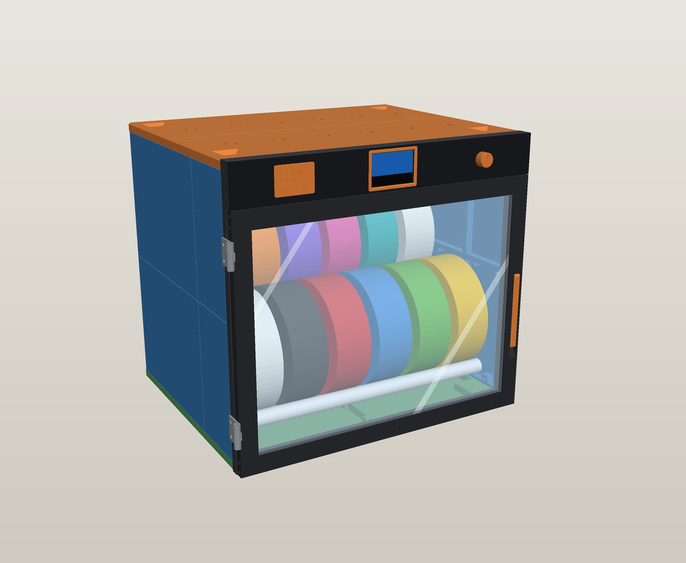
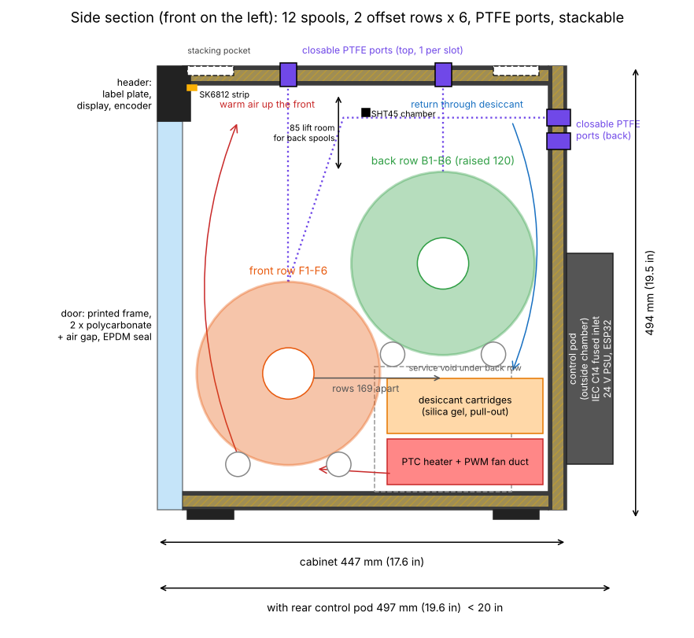

# Filament Dry Cabinet

A modular cabinet that stores **12 × 1 kg spools** and keeps them dry. A low-voltage **PTC heater** circulates warm air through **pull-out silica gel cartridges**. An **ESP32 running ESPHome** controls it, with a local display and knob for setpoints, and integrates with Home Assistant. **SK6812** lighting can highlight individual slots. Each spool position has an ID (`PETG-F3`, for example) for Spoolman's Location field. You'll build **one cabinet per material**. It plugs in through an **IEC C14 fused inlet** (120 V). At **19.4 in deep and 19.4 in tall**, it fits standard 20 in shelves. Cabinets **stack**, and **closable PTFE ports** on the top and back can feed a printer straight from any slot.

**Status: CAD complete.** The shell (§13), front frame and header (§14), door (§15), rear pod (§16) and interior drying unit (§17), plus the fit-test coupons (§12). The as-built parts list is in **[BOM.md](BOM.md)** (about $793 for one cabinet). The ESPHome firmware and the PN5180 component are next. See **[DESIGN.md](DESIGN.md)** for the full spec.

*Concept renders drawn from the spec dimensions. Shapes are simplified; this is not CAD.*

## At a Glance

| | |
|---|---|
| Capacity | 12 spools: two rows of 6, with the back row raised 120 mm |
| Size | 531 W × 442 D (492 with rear control pod) × 494 H mm (20.9 × 17.4 / 19.4 × 19.4 in) |
| Shelves | 3/4 in Sch 40 PVC rods in printed cradles, with printed index collars every 80 mm |
| Shell | Printed ABS/ASA tile panels (≤ 330 mm) with 1/2 in XPS foam, and a twin-pane polycarbonate door |
| PTFE ports | 12 on top (one per slot) + 12 on the back. Each one takes a PTFE pass-through module (PC4-M10) or a sealed blank plug. |
| Stacking | Feet nest into pockets in the cabinet below, with optional side links. Stacks of 2–3. |
| Drying | 24 V PTC heater, 150 W in every cabinet with PID (autotune), + PWM fan + about 700 g of silica gel |
| Control | ESP32-S3, SHT45/SHT40, 3.5 in IPS capacitive touchscreen TFT, 480 × 320 (shows the label; touch firmware later) + encoder, ESPHome |
| NFC | **PN5180 tap pad** in the header for **OpenPrintTag** (ISO 15693) and NTAG tags. Tap a spool and pick a slot, and Spoolman's Location updates. |
| Power | 120 V IEC C14 fused and switched inlet → Mean Well 24 V PSU in a rear pod outside the chamber |
| Door | Twin-pane polycarbonate, soft neoprene seal, flush lift-bar handle that is also a draw-in latch |
| Safety | Hardware thermal cutouts (85 °C auto-reset on a heater relay + 102 °C fuse) and firmware interlocks |

## Files

| File | Description |
|------|-------------|
| [`pcb/`](pcb/README.md) | Electronics: two KiCad PCBs (controller + front breakout) built from `circuit.py`, with Gerbers, schematic and per-board BOMs |
| [`cad/`](cad/) | Parametric CAD: `params.py` (all dimensions), `coupons.py` (fit-test parts), `tiles.py` (20 shell tiles, feet, cradles), `front.py` (frame, header, LED rails), `door.py` (door, hinges, lift-bar latch, tag), `render_latch.py` (latch renders and animation), `latch_coupon.py` (latch fit-test coupon), `pod.py` (rear pod), `interior.py` (desiccant, plenum, heater and floor ducts, sensor housings), `verify*.py` (assembly and swing checks), `preview.py` / `render_tiles.py` (images); STLs in `cad/stl/` |
| [`DESIGN.md`](DESIGN.md) | Full design spec: requirements, layout options, construction, drying, electronics, ESPHome entities, Spoolman scheme, parts list, open questions |
| [`BOM.md`](BOM.md), [`BOM.csv`](BOM.csv) | As-built bill of materials: links, prices, quantities, where each part is used, status and test results. Generated from `bom/bom_source.csv` by `bom/build_bom.py` |
| [`QA_REVIEW.md`](QA_REVIEW.md) | Design and CAD QA review: what was fixed, and prioritised recommendations |
| [`images/render_front.jpg`](images/render_front.jpg), [`render_stack.jpg`](images/render_stack.jpg), [`render_rear.jpg`](images/render_rear.jpg) | Concept renders (front, stacked pair, rear) |
| [`images/wiring.png`](images/wiring.png) | Electrical block diagram |
| [`source/layout.py`](source/layout.py) | Layout calculator. Change the spool and rod sizes or the offset and rerun it. |
| [`source/draw.py`](source/draw.py), [`source/wiring.py`](source/wiring.py) | Scripts that draw the layout and wiring figures |
| [`source/render/`](source/render/) | Render scripts (`scene.py` builds the model from the layout numbers, `views.py` renders the three views) |

## License

- **Design files and docs** (STL/STEP, DESIGN.md, drawings, renders): [CC BY-NC-SA 4.0](https://creativecommons.org/licenses/by-nc-sa/4.0/). Free to build, modify and share with credit, but **no commercial use**, and remixes keep the same license.
- **Code** (Python in `cad/`, `source/` and `bom/`, and the ESPHome YAML and components when they're added): **MIT**.
- The display vendor's drawing and pinout in `docs/`, and `images/concept.jpg`, aren't covered.

See [`LICENSE.md`](LICENSE.md).

## Revision History

- **v0.18** (2026-11-25): **Custom PCBs** replace the protoboard. The controller board (rear pod) carries a socketed ESP32-S3 DevKitC-1, the relay and MOSFET heater stage, the fan driver, fuses and sensor inputs. The front breakout (header bay) carries the display, NFC and encoder headers and the LED level shifter. A 26-way ribbon joins them. Files: KiCad boards, Gerbers, schematic and per-board BOMs in `pcb/`. Also a **latch fit-test coupon**. BOM: every board part on its own line; ESP32 is now the official Espressif DevKitC-1-N8R8. About $965.
- **v0.17** (2026-11-24): **Flush lift-bar latch** replaces the side lever. The handle is a bar flush in the right door stile; pull its bottom end and a hidden hook drops off a steel pin in the frame stile, then the door opens. Push the door shut and it latches itself; press the bar flush and it draws the door up to 2 mm onto the seal. Nothing sticks out past the door. Renders: closed, pulled, hidden parts, a 5-step section and an animation. BOM: post, sleeve, insert, washer and M3 × 12 removed; M3 × 25 and M3 × 16 flat heads added. About $931.
- **v0.16** (2026-11-24): QA fixes in the CAD and a fully broken-out BOM. **Door:** printed **draw latch** after the Clicky-Clack door (lever on the door edge, post on the frame stile, ramp draws the door in about 2 mm, magnetic click), D-pull handle removed; seal changed to 5 × 3 mm soft neoprene at 33 % squeeze (was EPDM at 50 %); one-piece hinge frame leaves, knuckles Ø11. **Interior:** PTFE pads under the heater; heater relay so the KSD301 switches a coil, not 6 A DC. **Tiles:** name debossed on each tile, 3 mm chamfered outside corners, foot base band. LED rail knife edges clipped. **BOM:** 71 lines, each part and passive on its own line, a protoboard for the electronics, an alternate source and link for every part, no auction sites. About $936. HP05-1/22 heater dropped (wrong part); a generic finned PTC is listed until a heater with a known surface temperature is confirmed.
- **v0.15.1** (2026-11-24): design and CAD **QA review** ([`QA_REVIEW.md`](QA_REVIEW.md)). Fixed: 11 threaded STLs had non-manifold (pinched) edges, now all 66 STLs are watertight when welded and `save()` checks for it; the desiccant lid was exported upside down. BOM: 12 PC4-M10 couplers, not 24 ($781). Open recommendations: lower-temperature PTC and a relay for the KSD301, test the door seal force, one-piece hinge leaves, CPVC rods for 55–60 °C cabinets, part labels on the tiles.
- **v0.15** (2026-11-24): as-built **bill of materials** for the first test build: [`BOM.md`](BOM.md) / [`BOM.csv`](BOM.csv), 42 lines with links, prices, quantities from the CAD, where each part is used, and status and test columns. About $793 for one cabinet. Filament estimate raised to 7 kg (from the STL volumes). DESIGN §9 now points to it.
- **v0.14** (2026-11-24): CAD phase 6, the interior: two lift-out desiccant cartridges (645 cm³ each) under back slots 1 and 6, a plenum with the 80 mm fan, a stepped heater duct (KSD301, TCO, NTC), a floor duct to the door, and sensor housings. **Correction:** a back spool comes out only after the front spool in its slot is removed (the earlier spec said it could go over the front spool). Removal paths are simulated in CAD. The 85 mm of headroom is kept, and the cabinet stays 19.4 in tall.
- **v0.13** (2026-11-24): CAD phase 5, the rear control pod. It's 330 × 230 × 50 mm: LRS-200-24 on rails with clamp bars, a snap-in IEC inlet in the side wall, two drillable carrier plates, a vented cover with the mains warning, and a gland module in the 13th back socket. The pod inserts in the back tiles moved to suit it. The header cable now runs through the chamber to the gland (header pass-through enlarged to Ø10). All assembly checks re-run clean. Details in DESIGN §16.
- **v0.12** (2026-11-24): CAD phase 4, the door. 30 mm members with twin polycarbonate panes (488.4 × 372.5 mm each) in grooves, rails in halves with a welded tenon, printed hinges with M3 pins, 4 magnets (catch + reed), D-pull, slot numbers 1–6 and the backup tag. Swing checked clear to 110°, and the seal loop is fully backed. Details in DESIGN §15.
- **v0.11** (2026-11-24): CAD phase 3, the front frame and header. The frame ring is two stiles, a split bottom rail and the header lip, with hinge inserts, magnet and reed pockets and a reed wire channel. The header is 3 chassis pieces and 3 fascias (NFC pad, 3.5 in TFT bezel with standoffs, encoder), plus 2 LED rails inside. The door opening is 480 × 377.8 mm. Verified against the shell. Parts, hardware and print notes are in DESIGN §14.
- **v0.10.1** (2026-11-24): O-ring groove on the port modules tightened (22.6 ID × 2.5 wide, was 22.0 × 2.7) after the test ring sat loose. The ring now stretches onto the groove's inner wall.
- **v0.10** (2026-11-23): CAD phase 2, the full shell: 20 tiles (all ≤ 299 × 226 mm) with port sockets, stacking pockets, cradle, pod and foot inserts, plus 4 feet and 8 rod cradles. Top and bottom span the full width so the walls carry the load. Assembly verified in CAD (no overlaps, every bolt station clear, rods and stacking fit). Parts list, hardware, foam sizes and assembly order are in DESIGN §13.
- **v0.9.2** (2026-11-23): first fit-test results in ABS: port socket clearance 0.25 mm chosen, tile groove fixed to an even 0.05 mm offset of the V tongue (reprint `tile_joint_b` to confirm), foam (0.5 in) and PVC (1.05 in OD) confirmed.
- **v0.9.1** (2026-11-22): display chosen: **3.5 in IPS 480 × 320 SPI TFT with FT6336U capacitive touch** (Haldzemo, 98 × 55.5 mm board). It still fits the 68 mm header. Mounting, bezel window, pinout and wiring notes are in DESIGN §6.6, and the vendor drawing and pinout are in `docs/`.
- **v0.9** (2026-11-22): display changed to a **3.2 in IPS capacitive touch TFT** (FT6336U boards are mostly 3.2 in). The header grows from 60 to 68 mm to fit it, so the cabinet is 494 mm (19.4 in) tall, 484 mm per cabinet when stacked. Figures and renders updated.
- **v0.8.1** (2026-11-22): the BOM uses the **capacitive touchscreen** version of the 2.8 in display (FT6336U on I2C, INT/RST pins reserved) so touch can be added in firmware later. The rotary encoder stays.
- **v0.8** (2026-11-22): the printed label plate is replaced by a **2.8 in IPS TFT that shows the material name** on a colour band, with status below. Added cabinet name, label colour and idle brightness settings, the screen behaviour, a backup tag on the door rail, and updated the header layout, figures and renders.
- **v0.7** (2026-11-22): CAD phase 1, fit-test coupons for the port thread and O-ring, PC4-M10 hole, rod cradle, index collar, tile joint, inserts and foam pocket. Walls are now 15.7 mm (2.4 mm skin + 1/2 in foam), so the outside is 531 × 442 (492) × 485 mm. The O-ring is now 22 × 2 mm. Index collars now slide on from the rod end.
- **v0.6.1** (2026-11-22): added concept renders (front, stacked PLA + PETG pair, rear). No spec changes.
- **v0.6** (2026-11-22): added an OpenPrintTag NFC reader: a PN5180 tap pad in the header, a Spools menu for checking spools in and out, an HA → Spoolman flow, and the ESPHome PN5180 component as new firmware work.
- **v0.5** (2026-11-22): RGB colour options for the lights: a preset colour list and a custom RGB colour, set from the encoder menu or Home Assistant.
- **v0.4** (2026-11-22): PID autotune now starts from the encoder menu (Tuning → PID autotune), with a confirmation step, instead of a button. Added a draft menu layout.
- **v0.3** (2026-11-22): every cabinet uses the same parts: a 150 W heater and Mean Well LRS-200-24, with PID control and autotune for each cabinet.
- **v0.2** (2026-11-22): decisions added: 20 in shelves (cabinet 19.5 in tall, lift room kept), closable PTFE ports on the top and back, stacking, 2.0 in TFT, 120 V only, ABS/ASA shell.
- **v0.1** (2026-11-22): first design spec and layout for review.
