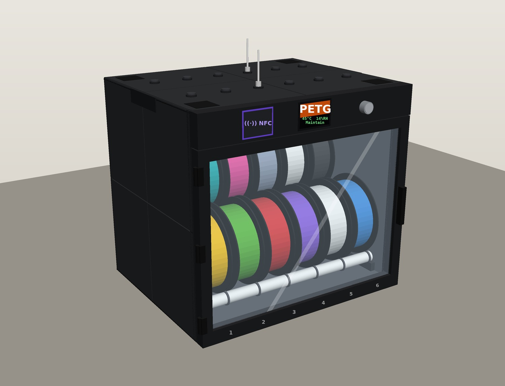
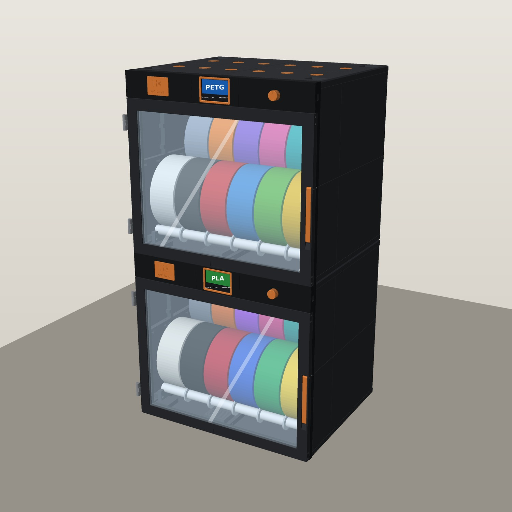
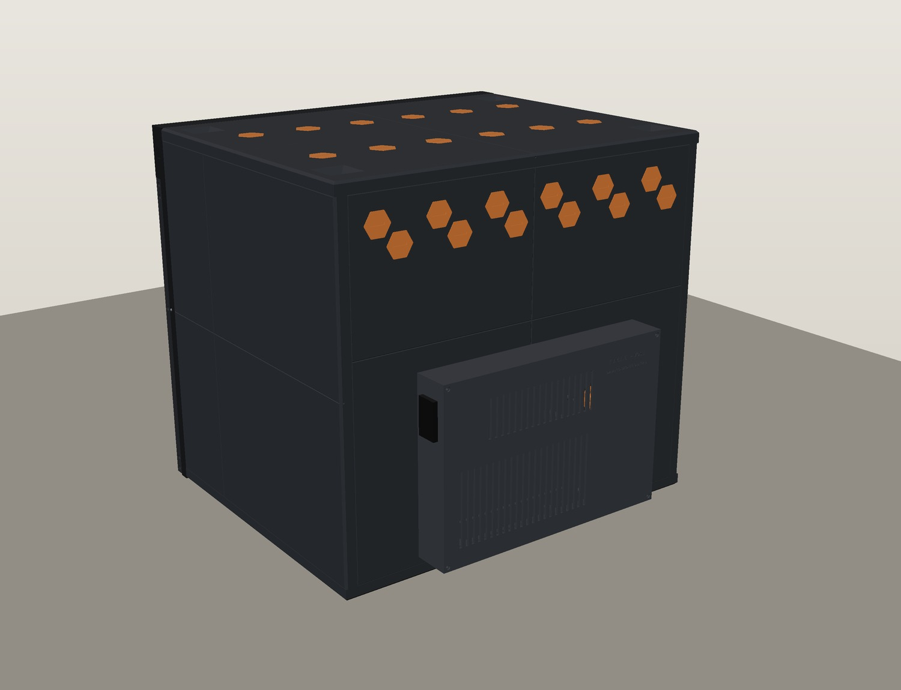
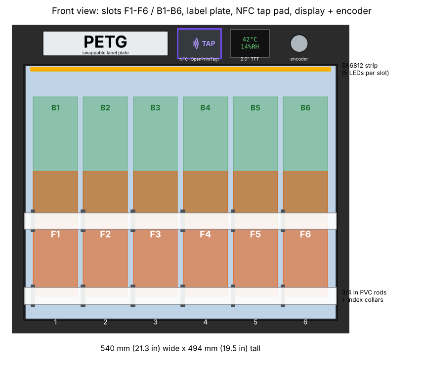

# Filament Dry Cabinet

A modular cabinet that stores **12 × 1 kg spools** and keeps them dry. A low-voltage **PTC heater** circulates warm air through **pull-out silica gel cartridges**. An **ESP32 running ESPHome** controls it, with a local display and knob for setpoints, and integrates with Home Assistant. **SK6812** lighting can highlight individual slots. Each spool position has an ID (`PETG-F3`, for example) for Spoolman's Location field. You'll build **one cabinet per material**. It plugs in through an **IEC C14 fused inlet** (120 V). At **19.6 in deep and 19.5 in tall**, it fits standard 20 in shelves. Cabinets **stack**, and **closable PTFE ports** on the top and back can feed a printer straight from any slot.

**Status: CAD phase 1. Fit-test coupons are ready to print** (DESIGN.md §12). See **[DESIGN.md](DESIGN.md)** for the full spec.

*Concept renders drawn from the v0.6 spec dimensions (walls since slimmed to 15.7 mm). Shapes are simplified; this is not CAD.*

## At a Glance

| | |
|---|---|
| Capacity | 12 spools: two rows of 6, with the back row raised 120 mm |
| Size | 531 W × 442 D (492 with rear control pod) × 485 H mm (20.9 × 17.4 / 19.4 × 19.1 in) |
| Shelves | 3/4 in Sch 40 PVC rods in printed cradles, with printed index collars every 80 mm |
| Shell | Printed ABS/ASA tile panels (≤ 330 mm) with 1/2 in XPS foam, and a twin-pane polycarbonate door |
| PTFE ports | 12 on top (one per slot) + 12 on the back. Each one takes a PTFE pass-through module (PC4-M10) or a sealed blank plug. |
| Stacking | Feet nest into pockets in the cabinet below, with optional side links. Stacks of 2–3. |
| Drying | 24 V PTC heater, 150 W in every cabinet with PID (autotune), + PWM fan + about 700 g of silica gel |
| Control | ESP32-S3, SHT45/SHT40, 2.0 in TFT + encoder, ESPHome |
| NFC | **PN5180 tap pad** in the header for **OpenPrintTag** (ISO 15693) and NTAG tags. Tap a spool and pick a slot, and Spoolman's Location updates. |
| Power | 120 V IEC C14 fused and switched inlet → Mean Well 24 V PSU in a rear pod outside the chamber |
| Safety | Hardware thermal cutouts (85 °C auto-reset + 102 °C fuse) and firmware interlocks |

## Files

| File | Description |
|------|-------------|
| [`cad/`](cad/) | Parametric CAD: `params.py` (all dimensions), `coupons.py` (fit-test parts), `preview.py`; STLs in `cad/stl/` |
| [`DESIGN.md`](DESIGN.md) | Full design spec: requirements, layout options, construction, drying, electronics, ESPHome entities, Spoolman scheme, parts list, open questions |
| [`images/render_front.jpg`](images/render_front.jpg), [`render_stack.jpg`](images/render_stack.jpg), [`render_rear.jpg`](images/render_rear.jpg) | Concept renders (front, stacked pair, rear) |
| [`images/wiring.png`](images/wiring.png) | Electrical block diagram |
| [`source/layout.py`](source/layout.py) | Layout calculator. Change the spool and rod sizes or the offset and rerun it. |
| [`source/draw.py`](source/draw.py), [`source/wiring.py`](source/wiring.py) | Scripts that draw the layout and wiring figures |
| [`source/render/`](source/render/) | Render scripts (`scene.py` builds the model from the layout numbers, `views.py` renders the three views) |

## Revision History

- **v0.7** (2026-11-22): CAD phase 1, fit-test coupons for the port thread and O-ring, PC4-M10 hole, rod cradle, index collar, tile joint, inserts and foam pocket. Walls are now 15.7 mm (2.4 mm skin + 1/2 in foam), so the outside is 531 × 442 (492) × 485 mm. The O-ring is now 22 × 2 mm. Index collars now slide on from the rod end.
- **v0.6.1** (2026-11-22): added concept renders (front, stacked PLA + PETG pair, rear). No spec changes.
- **v0.6** (2026-11-22): added an OpenPrintTag NFC reader: a PN5180 tap pad in the header, a Spools menu for checking spools in and out, an HA → Spoolman flow, and the ESPHome PN5180 component as new firmware work.
- **v0.5** (2026-11-22): RGB colour options for the lights: a preset colour list and a custom RGB colour, set from the encoder menu or Home Assistant.
- **v0.4** (2026-11-22): PID autotune now starts from the encoder menu (Tuning → PID autotune), with a confirmation step, instead of a button. Added a draft menu layout.
- **v0.3** (2026-11-22): every cabinet uses the same parts: a 150 W heater and Mean Well LRS-200-24, with PID control and autotune for each cabinet.
- **v0.2** (2026-11-22): decisions added: 20 in shelves (cabinet 19.5 in tall, lift room kept), closable PTFE ports on the top and back, stacking, 2.0 in TFT, 120 V only, ABS/ASA shell.
- **v0.1** (2026-11-22): first design spec and layout for review.
