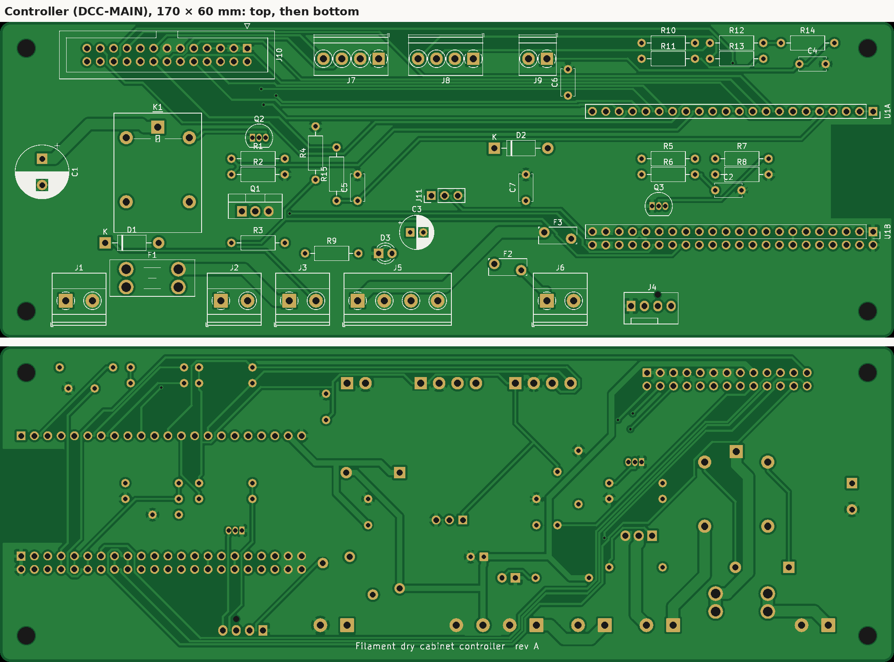
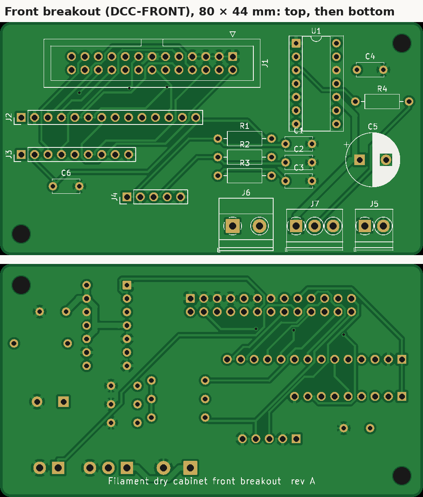

# Cabinet electronics: two PCBs

Replaces the Perma-Proto protoboard. Everything is through-hole, so it can all be hand-soldered.

| Board | Size | Where | What's on it |
|---|---|---|---|
| **DCC-MAIN** (`dcc_main/`) | 170 × 60 mm, 2 layers, **2 oz copper** | Rear pod, on `carrier_main` (4 × M3, 160 × 50 mm: on the carrier's 10 mm grid) | ESP32-S3-DevKitC-1 in sockets, 10 A blade fuse, heater relay (G5LE) + MOSFET, fan driver with tach input and its own 0.5 A PTC fuse, 5 V distribution with a 3 A PTC for the LEDs, I²C pull-ups, NTC divider, door-reed input, ribbon header |
| **DCC-FRONT** (`dcc_front/`) | 80 × 44 mm, 2 layers, 1 oz | Header bay, behind the display | Ribbon header, display / NFC / encoder headers, 74AHCT125 LED level shifter with 330 Ω and 1000 µF at the strip, encoder pull-ups and filters, door-reed terminal |





Schematic: [`schematic.pdf`](schematic.pdf) (also [`../images/pcb_schematic.png`](../images/pcb_schematic.png)).

## Ordering

Upload `dcc_main/dcc_main_gerbers.zip` and `dcc_front/dcc_front_gerbers.zip` as they are (Gerber + Excellon, KiCad names). Use the house defaults (1.6 mm FR-4, HASL or ENIG, any colour), but **order the controller with 2 oz outer copper**: the heater's 6.3 A runs through it on 2 mm tracks and both ground pours. Parts per board: `dcc_*_bom.csv`. They're also in the cabinet BOM.

## How the heater is switched

`+24V → F1 (10 A) → K1 relay contact → J2 heater (with the 102 °C TCO in its lead) → Q1 MOSFET → GND`

- **Q1 (GPIO45)** does the PWM (about a 5 s period in ESPHome `slow_pwm`).
- **K1** is the safety switch. Its coil is fed through the **KSD301 (J3)**, so at 85 °C the thermostat drops the relay whatever the firmware does. Q2 (GPIO46) lets the firmware drop it too, for the interlocks.
- **GPIO45 and GPIO46 are ESP32-S3 boot-strap pins.** Each has a 10 kΩ pull-down (R4, R2), which keeps it low at reset, as the chip needs. It also means the heater and relay are off while the board boots.

## Pin map and ribbon

The ESP32 pin map and the 26-way ribbon pinout are on the last two pages of the schematic, and in [`circuit.py`](circuit.py), which is the source for both boards.

- **Not used:** GPIO35–37 (octal PSRAM on the N8R8 module), GPIO19/20 (USB), GPIO43/44 (log UART), GPIO0 (BOOT), GPIO38/48 (the DevKit's RGB LED).
- **Fan PWM is inverted.** Q3 is an open collector, so set `inverted: true` on the ESPHome output. At boot Q3 is off, so the fan runs at full speed until the firmware takes over, which is the safe way round.
- **Ribbon:** in the flat cable, SCK, MOSI, MISO and the LED data line each sit next to a ground wire. Keep SPI at 10 MHz or less.

## DevKit header spacing

Espressif's drawing puts the two pin rows 22.86 mm apart, but some boards measure 25.4 mm. U1B has a **second row of holes 2.54 mm further out**, wired in parallel. Measure your board and solder the J3 socket into whichever row fits; leave the other row empty.

## Checks (run on every build)

- **DRC: 0 errors, 0 unconnected pads** on both boards. Reports: `dcc_*_drc.txt`. The only warnings left are silkscreen labels touching outlines.
- **Every pad's net matches `circuit.py`.**
- **Track widths:** heater and 24 V nets are 2.0 mm, 5 V nets 1.0 mm, signals 0.4 mm. Clearance is 0.2 mm (0.3 mm on the 24 V nets).
- **Copper keep-outs:** none under the DevKit's antenna, and none within 0.8 mm of the board edge.
- **Schematic cross-check:** all 43 parts drawn in the schematic are on the boards with the same values, and vice versa.

## Rebuild

```
python3 pcb/build.py        # place, autoroute, pour ground, DRC, Gerbers + drill, per-board BOM
python3 pcb/schematic.py    # schematic.pdf and images/pcb_schematic.png
```

You need KiCad 7 (`kicad-cli` and the `pcbnew` Python module), Java, `freerouting.jar` v1.9 (set `FREEROUTING` to its path), and `xvfb-run`. Placement lives in `circuit.py`: move a part there, rerun, and the router lays the tracks again. The `.kicad_pcb` files open in KiCad 7 or later if you'd rather edit the layout by hand.
