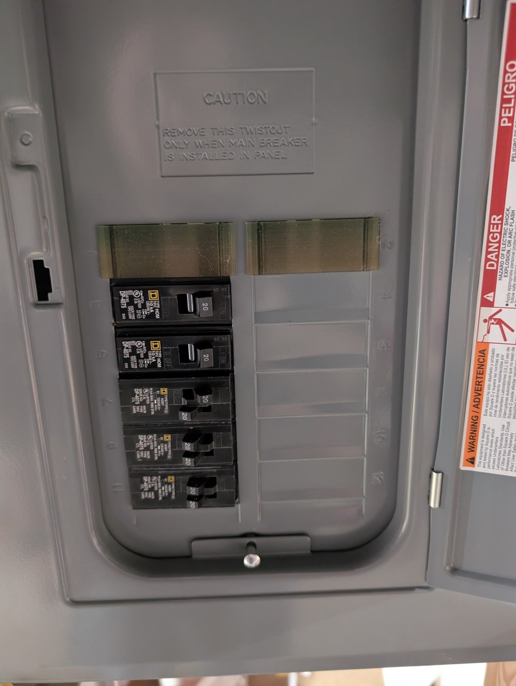
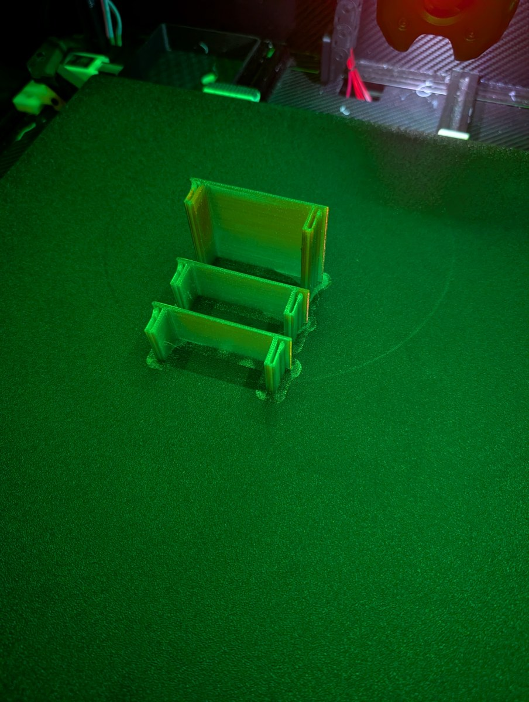
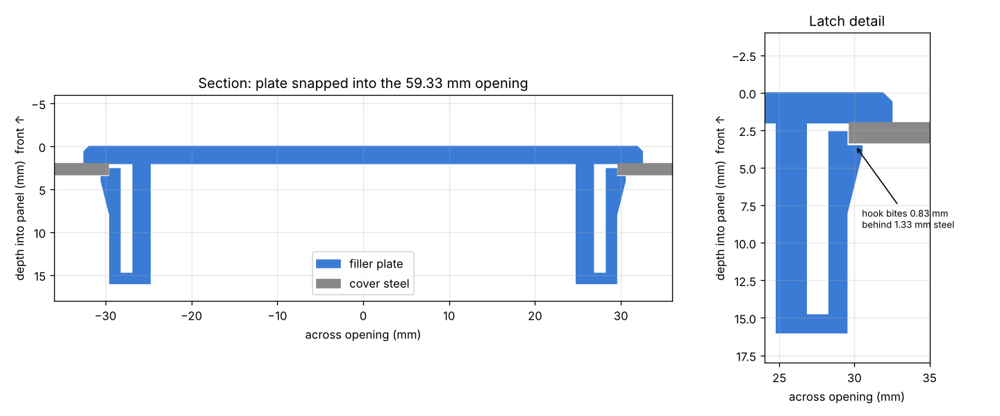
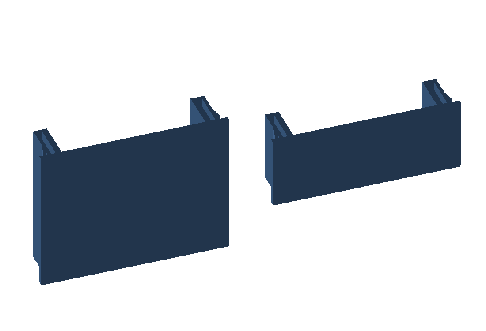

# Homeline Load Center Filler Plate

Snap-in plates that close empty breaker openings in a **Square D Homeline** load center cover. They're designed for the **HOM1224L125PGCVP** and inspired by Square D's **HOMFPCP**. There are two versions: **single-pole** (one 1 in space) and **double-pole** (two spaces). A folded spring latch at each end snaps behind the cover steel.

> ⚠️ **Safety and code.** Unused openings in a panel cover must be closed. The NEC (408.7) calls for closures *identified* for the purpose, meaning a listed part like the Square D **HOMFPCP** (about $7 for a 3-pack). These printed plates are **not listed**, so an inspector may reject them. They're best used as a temporary closure until the real part is in place. Print them in **ABS, ASA or PC (ideally a flame-retardant / V-0 grade), not PLA**, and check that each one snaps in firmly. Live parts sit right behind the opening, so always **turn off the main and remove the cover** before fitting or removing a plate.

| Printed on edge, with brims | Installed |
|---|---|
|  |  |

 

## Files

| File | Description |
|------|-------------|
| [`files/homeline_filler_plate_1pole.stl`](files/homeline_filler_plate_1pole.stl) / [`.step`](files/homeline_filler_plate_1pole.step) | Single-pole plate, 65 × 24.8 mm face |
| [`files/homeline_filler_plate_2pole.stl`](files/homeline_filler_plate_2pole.stl) / [`.step`](files/homeline_filler_plate_2pole.step) | Double-pole plate, 65 × 49.8 mm face |
| [`source/filler_plate.py`](source/filler_plate.py) | CadQuery script. All the measurements and latch settings are at the top. |

## Fit (measured on the HOM1224L125PGCVP cover)

| Item | Value |
|------|-------|
| Cover opening | 59.33 mm wide, 25 mm per breaker space, steel 1.33 mm thick at the edges |
| Opening edges | Plain flush cuts. Removed twist-outs leave one continuous slot down the column, so the plate latches **only on the two side edges**. |
| Face | 65.0 × 2.0 mm (the HOMFPCP is 2.56 in, about 65 mm), so it overlaps each side edge by about 2.8 mm. Height is 24.8 mm per pole minus a 0.2 mm gap, so neighbouring plates and breakers don't bind. Front edges chamfered 0.6 mm. |
| Depth | 16 mm overall, 14 mm behind the cover. There's more than an inch of clearance behind the cover. |
| Latch | A U-shaped spring leaf, 1.2 mm thick with 12.2 mm of free length, at each end. The hook sticks out 1.0 mm, so it **bites 0.83 mm behind the steel**, with 0.2 mm clearance to the back of the steel. A 14° lead-in ramp makes it easy to push in. |
| Leaf strain when snapping in | About 1.4% (1.17 mm deflection). That's comfortably within what ABS, ASA, PC and PETG can take. |
| Push-in force (estimated) | About 14 N per side for the single-pole and about 28 N per side for the double-pole |

## Print Settings

Printed on edge and fitted to the HOM1224L125PGCVP cover. They snap in and sit flush.

| Setting | Value |
|---------|-------|
| Orientation | **Stand the plate on its long edge**, with the 65 mm × 16 mm side on the bed and the face vertical. The part is a single profile extruded through its height, so it needs no supports. The spring leaves flex in the layer plane, which is much stronger than flexing across the layers. |
| Material | **Tested in PLA**: it prints cleanly and snaps in well. For a plate that stays in long-term, **ABS / ASA / PC** (ideally flame-retardant V-0) is the better choice. PLA softens at around 55–60 °C and can slowly relax under the constant spring load, which would loosen the latch. It also burns more readily. |
| Walls | 3 or more, so the 1.2 mm leaves print as solid perimeters |
| Infill | 100% (the part is almost all walls anyway) |
| **Brim** | **Use a brim, or mouse ears at the ends.** Standing on edge, the plate has a narrow footprint and grows tall, so a brim keeps it from lifting or tipping. |
| Layer height | 0.2 mm or finer |

## Installing

1. **Turn off the main breaker and remove the panel cover.**
2. From the front of the cover, push the plate into the opening until both hooks click behind the steel.
3. Check that it doesn't pull out, then reinstall the cover.

To remove a plate, take the cover off and squeeze the two spring leaves inward from behind.

## Notes

- If the plate is too tight or too loose, adjust `HOOK` (how far the hook sticks out) or `LEAF_T` (leaf stiffness) in the script.
- Other Homeline covers may have slightly different openings. Re-measure them and set `OPEN_W`, `SPACE_H` and `STEEL_T`.
- Square D, Homeline and HOMFPCP are trademarks of Schneider Electric. This is an original design that was only inspired by the HOMFPCP.

## License

Repository default: model files and docs are [CC BY-NC-SA 4.0](https://creativecommons.org/licenses/by-nc-sa/4.0/) (credit required, no commercial use, remixes keep the license). Code in `source/` is MIT. See the repository [`LICENSE`](../../LICENSE).

## Revision History

- **v1.0** (2026-11-21): first version, single- and double-pole. Printed in PLA on edge with a brim and installed in the cover, where they snap in and fit well.
