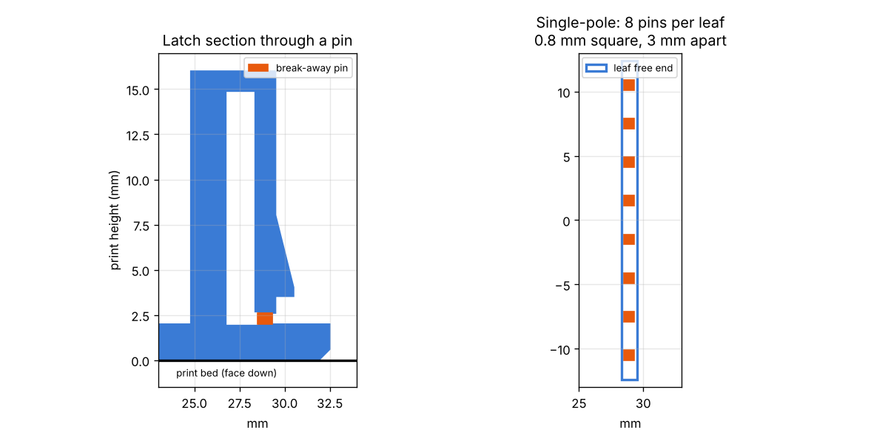

# Homeline Load Center Filler Plate

Snap-in plates that close empty breaker openings in a **Square D Homeline** load center cover. They're designed for the **HOM1224L125PGCVP** and inspired by Square D's **HOMFPCP**. There are two versions: **single-pole** (one 1 in space) and **double-pole** (two spaces). A folded spring latch at each end snaps behind the cover steel.

> ⚠️ **Safety and code.** Unused openings in a panel cover must be closed. The NEC (408.7) calls for closures *identified* for the purpose, meaning a listed part like the Square D **HOMFPCP** (about $7 for a 3-pack). These printed plates are **not listed**, so an inspector may reject them. They're best used as a temporary closure until the real part is in place. Print them in **ABS, ASA or PC (ideally a flame-retardant / V-0 grade), not PLA**, and check that each one snaps in firmly. Live parts sit right behind the opening, so always **turn off the main and remove the cover** before fitting or removing a plate.

## Files

| File | Description |
|------|-------------|
| [`files/homeline_filler_plate_1pole_flat.stl`](files/homeline_filler_plate_1pole_flat.stl) / [`.step`](files/homeline_filler_plate_1pole_flat.step) | Single-pole, **prints face-down**, with break-away pins under the spring leaves |
| [`files/homeline_filler_plate_2pole_flat.stl`](files/homeline_filler_plate_2pole_flat.stl) / [`.step`](files/homeline_filler_plate_2pole_flat.step) | Double-pole, **prints face-down**, with break-away pins under the spring leaves |
| [`files/homeline_filler_plate_1pole_edge.stl`](files/homeline_filler_plate_1pole_edge.stl) / [`.step`](files/homeline_filler_plate_1pole_edge.step) | Single-pole, **prints on its long edge**, no supports needed |
| [`files/homeline_filler_plate_2pole_edge.stl`](files/homeline_filler_plate_2pole_edge.stl) / [`.step`](files/homeline_filler_plate_2pole_edge.step) | Double-pole, **prints on its long edge**, no supports needed |
| [`source/filler_plate.py`](source/filler_plate.py) | CadQuery script. All the measurements and latch settings are at the top. |

## Fit (measured on the HOM1224L125PGCVP cover)

| Item | Value |
|------|-------|
| Cover opening | 59.33 mm wide, 25 mm per breaker space, steel 1.33 mm thick at the edges |
| Opening edges | Plain flush cuts. Removed twist-outs leave one continuous slot down the column, so the plate latches **only on the two side edges**. |
| Face | 65.0 × 2.0 mm (the HOMFPCP is 2.56 in, about 65 mm), so it overlaps each side edge by about 2.8 mm. Height is 24.8 mm per pole minus a 0.2 mm gap, so neighbouring plates and breakers don't bind. Front edges chamfered 0.6 mm. |
| Depth | 16 mm overall, 14 mm behind the cover. There's more than an inch of clearance behind the cover. |
| Latch | A U-shaped spring leaf, 1.2 mm thick with 12.2 mm of free length, at each end. The hook sticks out 1.0 mm, so it **bites 0.83 mm behind the steel**, with 0.2 mm clearance to the back of the steel. A 14° lead-in ramp makes it easy to push in. |
| Leaf strain when snapping in | About 1.4% (1.17 mm deflection). That's comfortably within what ABS, ASA, PC and PETG can take. |
| Push-in force (estimated) | About 14 N per side for the single-pole and about 28 N per side for the double-pole |

## Print Settings

Not printed yet. Suggested settings:

| Setting | Value |
|---------|-------|
| Orientation | **`_flat` files: face down on the bed.** Gives the best-looking face. The break-away pins hold up the spring leaves (see below). **`_edge` files: stand the plate on its long edge.** No supports are needed, and the spring leaves flex in the layer plane, so this is the strongest option. |
| Material | ABS / ASA / PC, preferably flame-retardant (V-0). **Not PLA.** It creeps and softens, and it's a poor choice inside an electrical enclosure. |
| Walls | 3 or more, so the 1.2 mm leaves print as solid perimeters |
| Infill | 100% (the part is almost all walls anyway) |
| Layer height | 0.2 mm or finer |

## Break-Away Supports (`_flat` files)

When the plate prints face-down, the free end of each spring leaf would start in mid-air, 0.6 mm above the face. **Small pins**, 0.8 mm square and 0.6 mm tall, tie the leaf to the face while it prints: 8 per leaf on the single-pole, 16 on the double-pole.

**After printing:** push each spring leaf inward (toward the centre of the plate) with a small screwdriver, and the pins snap off. Trim any stubs flush with a knife so the leaf moves freely. Then check that both leaves flex easily before you fit the plate.

**Trade-off:** face-down, the spring leaves bend across the layer lines, which is weaker than the `_edge` print. The 1.4% strain is fine for ASA, ABS or PETG with good layer adhesion. If a leaf cracks, switch to the `_edge` version.

## Installing

1. **Turn off the main breaker and remove the panel cover.**
2. From the front of the cover, push the plate into the opening until both hooks click behind the steel.
3. Check that it doesn't pull out, then reinstall the cover.

To remove a plate, take the cover off and squeeze the two spring leaves inward from behind.

## Notes

- If the plate is too tight or too loose, adjust `HOOK` (how far the hook sticks out) or `LEAF_T` (leaf stiffness) in the script.
- Other Homeline covers may have slightly different openings. Re-measure them and set `OPEN_W`, `SPACE_H` and `STEEL_T`.
- Square D, Homeline and HOMFPCP are trademarks of Schneider Electric. This is an original design that was only inspired by the HOMFPCP.

## Revision History

- **v1.1** (2026-11-21): added `_flat` versions that print face-down, with break-away pins under the spring leaves. The original no-support files are now `_edge`.
- **v1.0** (2026-11-21): first version, single- and double-pole.
