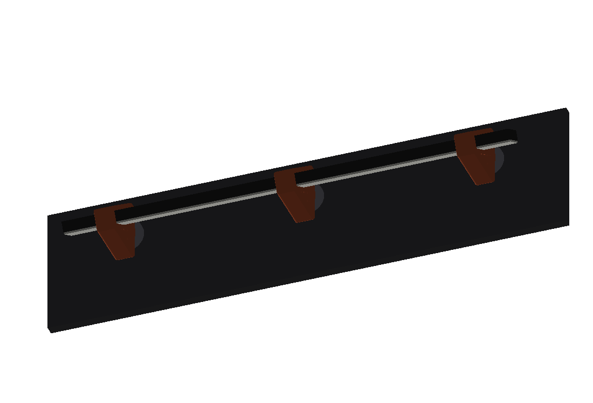
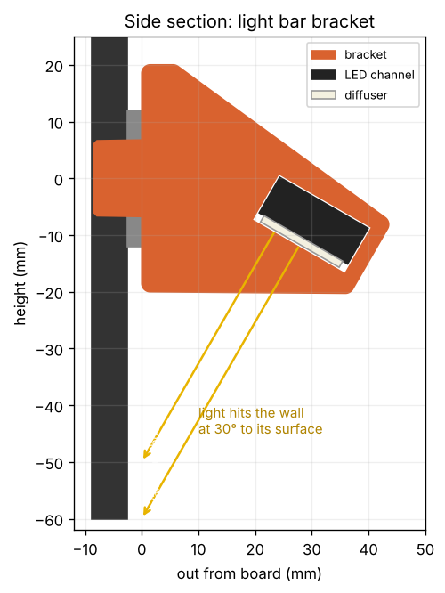
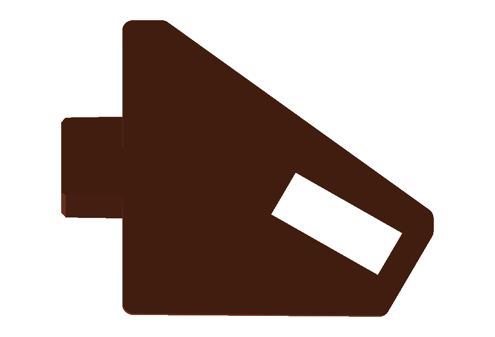

# Multiboard LED Light Bar

Wedge-shaped brackets hold an aluminium LED channel out from a Multiboard, with the diffuser facing **back and down toward the wall**. The light hits the wall at **30° to its surface**, which gives a long, soft wash downward. Each bracket presses onto a standard Multiboard **push-fit bolt**. The channel **passes straight through** each bracket, so there's just **one part**: use it at the ends, in the middle, or anywhere along the bar.

 

## Files

| File | Description |
|------|-------------|
| [`files/light_bar_bracket.stl`](files/light_bar_bracket.stl) / [`.step`](files/light_bar_bracket.step) | The bracket. The same part works anywhere along the bar. |
| [`source/light_bar_bracket.py`](source/light_bar_bracket.py) | CadQuery script. Change the light angle, channel size, standoff or clearance at the top and rerun it. |

## How Many Brackets

Use one bracket at each end, plus one about every **250–300 mm** in between. A 1 m channel needs **4–5 brackets**. Brackets can sit on any big hole along the row, so their spacing just has to be a multiple of 25 mm.

## Hardware / Bill of Materials

| Qty | Item | Notes |
|-----|------|-------|
| 1 | Aluminium LED channel with diffuser, **18 × 8.5 mm outer** (16 × 7 mm inside) | [Amazon](https://link.amazon/B0h3UVMNb): a kit of 1 m U-channels with diffusers, end caps and clips. Use the kit's end caps (one with a hole for the wire) on the channel ends. The mounting clips aren't needed. |
| 1 | LED strip, up to about 15 mm wide | Sits in the channel |
| 1 per bracket | Light bar bracket | This model |
| 1 per bracket | Multiboard **13 mm Big Thread – Flat Head – Push-Fit Hole – Bolt** | Printed. These screw into the Multiboard's big holes, and the brackets press into them. |

*Disclosure: the Amazon link above is an affiliate link. I may earn a commission on purchases made through it, at no extra cost to you.*

## Design

| Feature | Value |
|---------|-------|
| Light direction | Diffuser faces the wall. The light reaches the wall at 30° to its surface, aimed downward. |
| Channel opening | 18.4 × 8.9 mm through-hole (0.2 mm clearance per side), tilted to match the light angle |
| Channel position | Centre about 30 mm out from the board and 8 mm below the bolt centre |
| Bracket | 13.5 mm thick (the same as the plug, so the plug prints flat), 40 mm tall where it meets the board, about 44 mm deep. Edges rounded R1.5. |
| Push-fit plug | **Centred on the back face.** Octagon 13.5 mm across the flats at the base, tapering to 13.24 mm, 8.5 mm long, 0.6 mm tip chamfer. The size comes from the official Multiboard push-fit holder. |

### Channel length

The channel can be any length, because it passes through the brackets. Just let it overhang the end brackets by at least a few millimetres. The overhang can be longer if you want the light to run past the last bolt.

## Print Settings

Printed and tested. The bracket fits the channel and works well. These are the suggested settings:

| Setting | Value |
|---------|-------|
| Orientation | **Lay the bracket on either side face.** The plug is the same thickness as the bracket, so it lies flat on the bed, the way Multiboard push-fit parts are designed to print. |
| Supports | None |
| Walls / infill | 4 walls, 25–40% gyroid |
| Material | PETG or ABS. LED strips get warm, so avoid PLA if the strip runs bright. |

## Assembly

1. Screw a push-fit bolt into a big hole for each bracket, all on the same row. Stop when an octagon flat is level.
2. Put the LED strip in the channel, snap the diffuser on, and fit the end caps, with the wire coming out through the cap with the hole.
3. Slide all the brackets onto the channel, with the **diffuser facing the wall**, and line them up with the bolts.
4. Press all the plugs into their bolts. Working from one end to the other is easiest.

## Notes

- The opening has 0.2 mm of clearance per side, so the channel slides through easily. On the first print the fit worked but was a little loose. For a snugger fit, set `CLR` to 0.1 in the script. To stop the bar from sliding sideways, add a drop of glue or a wrap of tape on the channel at one bracket. If the channel is too tight, change `CLR` in the script.
- Multiboard is a trademark of its creator. These brackets are an original design made to fit the Multiboard push-fit system. Selling printed Multiboard parts may need Multiboard's commercial license.

## Revision History

- **v1.1** (2026-11-20): printed and tested. It fits the channel and works, with the channel a little loose (see Notes). The channel now passes through the bracket, and the push-fit plug is centred on the back face. Left and right are now one part that works anywhere along the bar. The bracket is 13.5 mm thick so the plug prints flat.
- **v1.0** (2026-11-20): first version. 30° downward wall wash, push-fit plug, left and right (wire) brackets.
