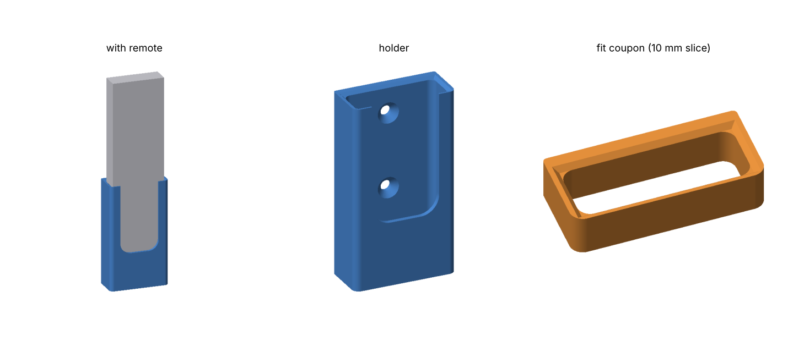

# Remote Control Wall Holder

A wall-mounted cradle for the white ON / OFF / Bright / Warm / Cool / CCT / RGB / RGB IC LED-light remote. The remote drops in from the top with its buttons facing out and rests on a floor. Front lips along both sides and a solid band across the bottom hold it snugly against the wall. To use it, lift it straight up and out. Two countersunk holes in the back take drywall screws.

## Files

| File | Description |
|------|-------------|
| [`files/remote_wall_holder.stl`](files/remote_wall_holder.stl) / [`.step`](files/remote_wall_holder.step) | The holder, 43.5 W × 19.8 D × 78 H mm |
| [`files/remote_fit_coupon.stl`](files/remote_fit_coupon.stl) / [`.step`](files/remote_fit_coupon.step) | 10 mm slice of the holder's cross-section. Print it first (about 10 minutes) and slide the remote through to check the fit. |
| [`source/remote_holder.py`](source/remote_holder.py) | CadQuery script. Remote measurements, clearances and screw positions are at the top. |
| [`source/render_preview.py`](source/render_preview.py) | Renders `images/preview.png` from the STLs |

## Fit

| Item | Value |
|------|-------|
| Remote (measured) | 151.26 L × 38.09 W × 13.34 T mm. The back is curved, so 13.34 is the thickest point. |
| Pocket | 38.69 × 13.84 mm (0.3 mm clearance per side across the width, 0.5 mm front to back), 3 mm corner radius |
| Depth in the holder | 75 mm, so about 76 mm of the remote sticks out above to grab |
| Front lips | Overlap 5 mm of each long edge of the remote, clear of the buttons |
| Front band | 24 mm tall across the bottom, over the blank lower end of the remote |
| Entry | 1.2 mm lead-in chamfer around the top of the pocket |
| Walls | 4 mm back, 2.4 mm sides, 2 mm front, 3 mm floor |
| Screw holes | 2 × 4.5 mm with 90° countersinks, 9 mm across, on the centre line at 34 mm and 66 mm above the bottom (32 mm apart). Both are visible through the front opening, so a driver reaches them straight on. |

## Print Settings

| Setting | Value |
|---------|-------|
| Material | PLA or PETG |
| Orientation | **Upright, floor on the bed**, as exported. The lips and front band are vertical walls, so there are no supports and no bridges. |
| Layer height | 0.2 mm |
| Walls / perimeters | 3 |
| Infill | 20% |
| Supports | None |
| Brim | Optional. The footprint is 43.5 × 19.8 mm for a 78 mm tall part, so add a few mm of brim if your bed adhesion is marginal. |

## Hardware / Bill of Materials

| Qty | Item | Notes |
|-----|------|-------|
| 2 | #6 or #8 drywall screw, 1¼ in | Bugle heads sit in the countersinks |
| 2 | Drywall anchors (optional) | Recommended unless you hit a stud. The remote is light, but bare drywall screws can loosen from repeated pulls. |

## Assembly / Usage

1. Print the fit coupon and slide the remote through it. It should slide without forcing and not rattle. Adjust `CLR_W` / `CLR_T` in the script if needed and re-export.
2. Print the holder.
3. Hold it level against the wall, mark both holes, and fit anchors if you're not in a stud.
4. Screw it on through the front opening. Drive the screws until the heads sit flush in the countersinks, but don't crush the plastic.
5. Drop the remote in from the top, buttons facing out.

## Notes

- **Too loose or too tight?** Change `CLR_W` (width) or `CLR_T` (thickness) at the top of `source/remote_holder.py` and run `python3 source/remote_holder.py files` from this folder. Then run `python3 source/render_preview.py` to refresh the preview.
- **More or less of the remote showing:** change `DEPTH_IN`. If you move it, keep both `SCREW_Z` holes above `FLOOR + BAND_H` and below the top, so the driver can still reach them.
- The pocket is a rounded rectangle. The remote's curved back only touches it along the centre, and the front lips keep it from rocking.

## Revision History

- **v1.0** (2026-11-22): initial version, sized from caliper measurements. Not yet printed.

## License

Repository default: model files and docs are [CC BY-NC-SA 4.0](https://creativecommons.org/licenses/by-nc-sa/4.0/) (credit required, no commercial use, remixes keep the license). Code in `source/` is MIT. See the repository [`LICENSE`](../../LICENSE).
